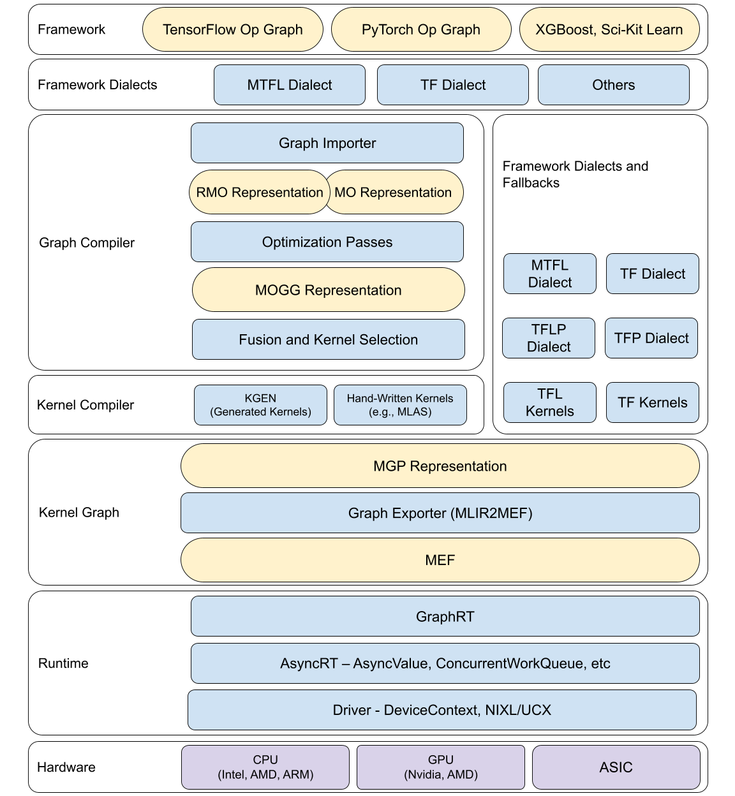

# Modular Graph Compiler

The graph compiler is a suite of layers in the Modular stack intended to
provide a framework-agnostic set of high level operations, graph optimizations,
lowering tools and runtime. We expect that most of the optimizations important
to Modular will hook into frameworks via the graph compiler. Framework
fallbacks will live alongside modular-specific implementations.

This document is a work in process and technical details will likely change over
the next couple of milestones. To see the history of discussion that predated
this version of the document, look at the
[Original Design Exploration](https://www.notion.so/modularai/Graph-Compiler-Design-Points-8db653075b7e4994a0916ef12f8b9083)
and the
[11/17/22 Onsite notes](https://www.notion.so/modularai/Graph-Compiler-Design-Points-8db653075b7e4994a0916ef12f8b9083).

[Original Image](https://docs.google.com/drawings/d/1MwVbZPdFVxe5jy4pr5ymJs_0olsiPNR1EOuBgRwTkWI/edit).

## RMO (Relaxed Modular Operations) Dialect

Whereas [MO operators](#mo-modular-operations-dialect) are designed to be
strongly typed and do a single thing, RMO is designed to relax this philosophy.

The main issue with MO being strongly typed is it makes it extremely cumbersome
to build graphs from MO operators. Typically it requires the user to either do
some kind of shape inference as is done in some of our frontends. Some
frontends have little shape information so all dimensions are `?`, which forced
MO to carve out special exceptions to its strongly typed nature to deal with
`?`. Therefore not only are MO graphs hard to build, its hard type system is
also inconsistent with itself!

RMO handles all of these unknown types, and allows MO to maintain its
strongly-typed stance.

### Main Design Points

1. All RMO operators do not have shape-based verifiers. Instead the paradigm is
   to lower to other RMO or MO operators, inserting rebinds with dynamic
   runtime checks as needed.
2. All RMO operators lower to a MO operator or an RMO operator which lowers to
   MO eventually.
3. RMO operators are either a `MOAnalogue` or an `RMOComposite` operator.
4. `MOAnalogue` operators match semantics with an associated MO operator in a
   1-1 fashion. The only difference is RMO accepts all shapes, and lowers to the
   compatible shaped MO operation. For example `rmo.add` will lower to `mo.add`
   with some rebinds and dynamic runtime checks inserted.
5. `RMOComposite` operators are operators which should only lower to other rmo
   operators.
6. `?` returns to its proper place as sugar for "Unique Parameter." It is the
   goal that MO operators are never created directly, except through RMO.
   Therefore MO will not have to deal with `?` anymore and the special
   carve-outs in the MO verifiers for this can be removed.
7. Taking advantage of the looser type system to make RMO easier to write,
   we add builders for `MOAnalogue` operators that have implicit return types.

## MO (Modular Operations) Dialect

MO is intended to be the framework-level interface to Modular optimizations.
Supported-in-MO operators from Tensorflow, TFLite, and other frameworks will
be lowered to MO and will take advantage of optimizations, and for not-
supported ops the default framework implementation will be used. This will
ensure long-tail coverage of user models.

MO will initially focus purely on value semantics (all ops look like
`return_value = op(input_values...)`), and use explicit broadcasting for
backend lowering simplicity. In the long run, we expect to rebase this into
numpy-like implicit broadcasting for alignment with the rest of the kernel
libraries and framework frontends.

### Type System

We would like to introduce a graph-level tensor type that is independent of
those used by the various runtimes and frameworks. For the most part, we would
like to keep the feature set of the built-in MLIR tensor. However, it has many
extensions we don't need at Modular (i.e., affine integration), and is missing
features we do need (i.e, M::DType). Thus, we will fork the builtin tensor and
`hack-to-own`.

We will extend the built-in tensor with the following features:

- Shape
  - Dynamic shapes and ranks
- Element Data Type
  - Based on the extensible M::DType, supported by including dynamic
    `NoneType` from the builtin dialect
- Layout information (e.g. “NHWC” or “row major”)
- Quantization information
  - Including quantization method (affine, log, etc.)
  - Quantization parameters (e.g. scale and zero point)
- Target (i.e. device placement) information

Each of these features will need to be extensible to support both future
Modular extensions for new kernels, models, and devices, but also to ensure
that user-defined optimizations are given first class support next to
Modular-provided implementations.

As an example, Target will need to describe numa-aware CPUs, heterogenous
shared memory devices (such as an M1 SOC), multi-accelerator systems, and
multi-server systems, among others.

To support dynamism at runtime, we will need to implement shape and type
inference functions for each op that can be executed as part of the model
runtime. To provide a single source of truth, these functions will be written
in MLIR::ShapeDialect so they can be partially evaluated for compile-time
static shapes or embedded in the lowered program for runtime shape/type
inference and dynamic memory allocation.

### Core Operations

- ConstantOp
- GraphOp
  - Which serves as a model container and function
- OutputOp
  - To satisfy termination requirements for the GraphOp
- IfOp
  - For control flow, use MLIR regions in the ops instead of embedding GraphOp
- WhileOp
  - For control flow, use MLIR regions in the ops instead of embedding GraphOp
- SendOp
  - To model device transfers

If, While, and perhaps Send are expected in E, but will not be implemented in D

### HLOs (High Level Operations)

In the fullness of time, we would like the HLOs of MO (matmul, add, conv, etc)
to be defined in lightning as a Modular Standard Library. This will allow us to
treat user-defined lightning ops as first class citizens along side
Modular defined ops.

For the next couple of milestones, we will define these ops in TableGen to
bootstrap the development effort while lightning matures for this use case.

### Lowering Pipeline

Beginning with a framework model, we will first partially lower the graph
into MO. Afterward we will further lower the mHLO into MO.

Once a model is defined in MO, we can run a set of device independent passes
(shape inference, constant folding, simplification, etc). From this point,
lowering passes become increasingly specific to the target and implementation
of the underlying kernel models. The specificity of types on the tensors and
attributes on ops will necessarily vary through this process.

- For instance, we begin with a graph with no explicit device or layout
information.

- We run a pass that assigns device and layout, possibly with a future search
algorithm.
  - This increases specificity in the type system

- We run a pass that transforms QAT (Quantization Aware Training) graphs into
integer ops, and canonicalizes them.
  - Quantized type information is useful for the QAT transformation, but
    canonicalization removes quantization parameters from the type system

- We then run a pass that searches and selects what kernel interface we want to
run (i.e., winograd conv vs im2col vs direct) via a search mechanism
  - This increases specificity of ops to a state that is no longer HLO, ops
    now contain implementation information, and they are lowered to the
    MAP dialect (and from there, after fusion, to MOGG).

## MAP (Modular Access Primitives) Dialect

MAP expresses executable loop nests/kernels that load and store tensors and
perform computation. It is the stage where advanced fusion runs: after MO is
lowered to one MAP kernel per op (`MOToMAP`), the MAP pipeline fuses elementwise
chains, views, and prologue/epilogue computation around structured kernels, then
lowers the fused kernels into MOGG (`MAPToMOGG`).

Fusion eligibility is a function of kernel structure, not op identity: a kernel
is fusable when it uses the proper Mojo types for its inputs and outputs and
implements the relevant fusion interfaces (for example elementwise or
prologue/epilogue). MAP has two op families: `map.iter.opaque` wraps a
hand-written Mojo kernel with a fusible store epilogue, while
`map.iter.elementwise` expresses the loop body explicitly as per-index
`map.load` / `map.store` / `map.call.elementwise` ops.

The dialect is defined in
[`MAPDialect/Dialect`](../include/GraphCompiler/MAPDialect/Dialect);
see also the MAP passes in
[`Passes.md`](Passes.md) and the fusion contract in
[`ArchitectureSpecification.md`](ArchitectureSpecification.md).

## MOGG (Modular Operation Generator Graph) Dialect

MOGG is the codegen-focused dialect that MAP kernels lower into. This section
provides motivation and a high level design, but further design work is needed.

As a concrete example, there are two implementations of sgemm in mlas: one
which assumes nothing about the input, and another that assumes input tensors
are packed with zeros to hit a clean multiple of SIMD width. To support these
two kernels, we would need to implement two mogg ops:

- `mogg.matmul`, which would directly lower to `mlas.sgemm(x)`
or `kgen.sgemm(x)`
- `mogg.packed_matmul`, which would lower to `mlas.packed.sgemm(mlas.pack(x))`
or `kgen.packed.sgemm(kgen.pack(x))`

It may not be clear which of these interfaces is fastest for a given situation.
Thus, the lowering from MO->MOGG will be a tree-based search that reuses the
search and elaboration infrastructure developed for kGen.

Kernel fusion no longer happens in MOGG. The current pipeline lowers MO into the
[MAP dialect](#map-modular-access-primitives-dialect), runs advanced fusion
there, and only then lowers the fused MAP kernels into MOGG for code generation.
MOGG is now the codegen-focused IR that results from that lowering, rather than
the dialect where fusion decisions are made.

The fused kernel is then lowered to kGen for kernel generation and comparison of
kGen and hand-tuned kernel implementations of a given numerically specified
kernel.

TODO: Flesh out MOGG/kGen interface

Once kernels have been selected, MOGG will lower those kernels, generally in
buffer semantics to the MO dialect for integration with framework kernels,
memory optimizaiton, and lowering to MEF.

TODO: Flesh out MGP/kGen interface

## MGP (Modular Glue Primitives) Dialect

The dialect reference is generated from the TableGen definitions in
[`include/GraphCompiler/MGPDialect/Dialect`](../include/GraphCompiler/MGPDialect/Dialect);
build `//GraphCompiler:MGPDialect.doc` to render it.

## Not Yet Considered

- GPU (need some thought on heterogeneous compute)
- Auto differentiation for training
- Transformations for Model Parallelism (i.e./splitting or combining ops for
better parallelism
- Stateful Operations (in place updates on tensor slices, mutable
tensor arrays, etc.)
- Recomputation
  - In training generally you want to recompute the backward activations,
    especially if they can be fused.
