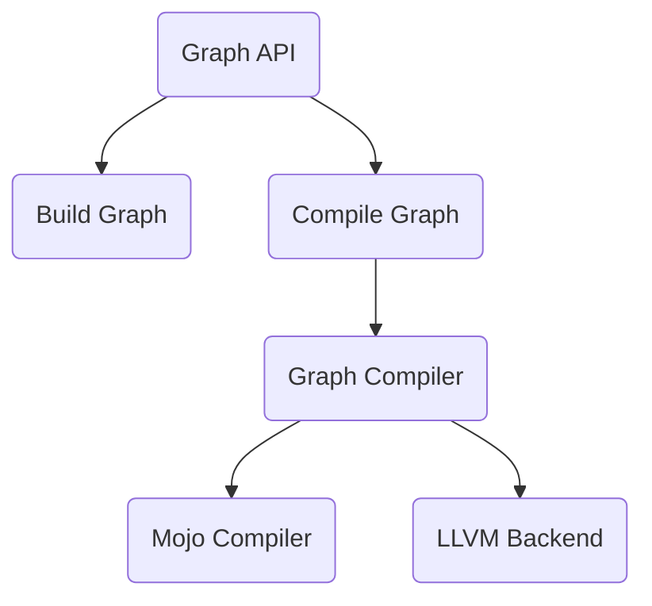

# So the Graph Compiler is slow, now what?

- Python code: Graph API or other code responsible for building the model.
- C++ code: called into from Python. Does not necessarily mean it is in "compile
  time".
- Model setup and initialization.
- Mojo compiler

The graph compiler is a large, multi-language piece of software. The size and
language boundaries make investigating performance regressions difficult.

## High-level flow of the Graph Compiler

There are three broad sections of the codebase where time could be spent while
building/compiling a model:

1. The Graph API (Python code building the model)
2. The Graph Compiler (C++ code lowering the model to KGEN)
3. The Mojo Compiler (C++ code elaborating the model to roughly LLVM level IR)
4. LLVM Compiler (final compilation and linking)


Each of these phases can be introspected separately once the regression has been
narrowed down into one of these buckets.

### Which bucket are we in?

While the compilation process can be viewed linearly, it is easier to diagnose
regressions with a top-down view of "who delegates to whom". Profiling will
often blame the person at the top of the stack if the profiler is not
fine-grained enough. With that in mind, we can break down the chain of
responsibility like this:



At the top-level, the Graph API drives the entire process. Most of our pipelines
follow the same form in the graph API of:

```python
model = self._build_graph()
compiled = session.load(model)
compiled(*model_args)
```

Many pipelines print the runtime spent in the 'Build Graph' and "Compile Graph"
(`session.load`) phases, which makes narrowing down between those two easy. Keep
in mind that the time in `session.load` includes

1. MEF cache lookups
2. The MLIR pipeline (everything under the "Compile Graph" subtree)
3. Model Initialization (30 seconds for Llama 405b)

## Slow Python Code

Slow Python code likely means the graph construction itself is slow, as graph
construction executes a lot of Python code. The graph compilation phase is
a thin wrapper over C++ code for the most part.

Python has some decent profiling libraries for tracking down hot spots. The
[`cProfile`](https://docs.python.org/3/library/profile.html) library is easy to
use and provides enough information to pinpoint hotspots in Python code.

For instance, assume that we think that `self._build_graph()` is too slow, wrap
it with the profiling context manager like so:

```python
import cProfile

with cProfile.Profile() as pr:
    self._build_graph()
    pr.print_stats()
```

That will dump a report to `stderr` containing time spent in the functions
called by `self._build_graph()`.

Keep in mind that `cProfile` only profiles the Python code. Code calling into
a large number of C extensions or heavily leveraging threads will not be
represented accurately. For instance `session.load` waits on a mutex while other
threads have a lock on the Graph Compiler internals. The profiling will simply
show all the execution time in `Mutex.wait`.

## Slow MLIR Pipeline

Slow C++ code typically involves code somewhere in the MLIR pipeline. The C++
code has a few semi-expensive steps:

- Setup the `MojoLibraryAnalysis`
- MEF cache lookups
- Run the MLIR compiler pipeline

Of those steps, running the MLIR pass pipeline is by far the most expensive.
Fortunately, MLIR has some nice utilities for narrowing down the runtime to
individual passes. The general procedure for investigating long compilation
times are:

- Obtain the IR at the start of the compilation process. Use the
  `MODULAR_MAX_TEMPS_DIR` environment variable to have our pipelines dump the
  MO graph to disk. For instance, we can dump the IR for Deepseek V2 using the
  following command:

```bash
MODULAR_MAX_TEMPS_DIR="path/to/dump" bazel run //max/python/max/_entrypoints:pipelines -- generate --model-path=deepseek-ai/DeepSeek-V2.5-1210 --trust-remote-code --max-batch-size=1 --max-length=1024 --devices="gpu:0,1,2,3" --max-new-tokens=2
```

- Use the MLIR pass timing infrastructure to capture the runtime of each pass
  in the `gc-pipeline` pipeline

```bash
bazel run //GraphCompiler/tools/mo-opt:mo-opt -- path/to/dump/temp.mo.mlir --gc-pipeline --mlir-timing -o /dev/null
```

The exact file name may depend on the model. Many pipelines will involve
multiple models, so you'll need to look through the various MO dialect dumps to
find the correct one.

That will provide a comprehensive list of pass timings, including time spent in
creating analyses used by those transforms. That information is typically enough
to narrow the search down to an individual pass.

> [!Consider]
> It is important to compare the IR before vs after the regression
> before blaming a particular transform. The transform itself could be slow, but
> it is also possible that an upstream transform began emitting more IR.

If the performance problem is indeed due to a particular transform, the best
course of action is to capture the IR before that pass and use `mo-opt` to
iterate on a solution.

### Timing within a transform

Individual transforms can be large, which means more fine-grained runtime
information is helpful. I have had good success with MLIR's timing library in
`mlir/Support/Timing.h`. This is the same library that drives the pass timings
through `--mlir-timing`, and can be used in general C++ code without too much
modification.

Say we want to drill down into which of the three stages in this hypothetical
transform is taking the most time.

```cpp
void runOnOperation() {
  auto stage1 = runStage1();

  runStage2(stage1);

  if (foo) {
    runStage3();
  }
}
```

The timing tooling has some nice RAII classes for managing timers, obtained from
the `DefaultTimingManager` class.

```cpp
#include "mlir/Support/Timing.h"

void runOnOperation() {
  mlir::DefaultTimingManager manager;
  manager.setEnabled(true);

  // The root timing scope that all other scoped timers
  // run under.
  auto root = manager.getRootScope();

  // Wrap the code in a lambda to time functions with return values
  auto stage1 = [&] {
    auto timer = root.nest("stage 1");
    return runStage1();
    }();

  // Create a new scope for simple function calls
  {
    auto time = root.nest("stage 2");
    runStage2(stage1);
  }

  // Just put the timer in the local scope if the local
  // scope is present already.
  if (foo) {
    auto time = root.nest("stage 3");
    runStage3();
  }
}
```

The `DefaultTimingManager` will dump a summary of the collected times to
`stderr` upon destruction, so no additional work is needed. In addition, this
timing information can be left in the pass after diagnosis and easily
enabled/disabled via `manager.setEnabled`.

## Common Pitfalls

### Caching

The Graph compiler has multiple levels of caching. Timing will differ greatly
between a hot and a cold run. Depending on where the regression is, caching can
completely mask the regression. Our CI based smoke detection always runs in
a clean cache, but that will not be true of any graphs you execute locally.

Where the cache is stored is system dependent, so consider using the
`clear-cache` alias provided by `start-modular.sh`. There are more fine-grained
aliases for clearing the various caches as well:

```bash
clear-mojo-cache     # Clear Mojo cache
clear-mojo-packages  # Clear built packages
clear-max-cache      # Clear MAX cache
clear-cache          # Clear all caches
```

### The `JitCompileKernels` transform

`JitCompileKernels` will always show up in a performance analysis as hot.
`JitCompileKernels` is expensive because it invokes large parts of the Mojo
compiler, including Elaboration and LLVM compilation. That full process is
expensive and difficult to improve upon without dedicated assistance from the
Mojo compiler team.

`JitCompileKernels` has its own cache called the MOGG cache. This is a cache
mapping kernel stubs to pre-compiled MEF artifacts. This provides more
fine-grained caching than the MEF cache, which works on the entire model. The
runtime of `JitCompileKernels` varies depending on which kernels are in the
cache, which can be influenced by changes to the backing Mojo code.

The same general rule applies to the `JitCompileKernels` transform as our other
caches: clear the relevant cache before trying to collect profiling info.
