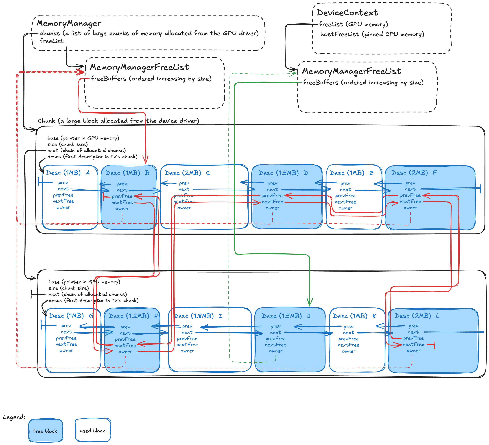
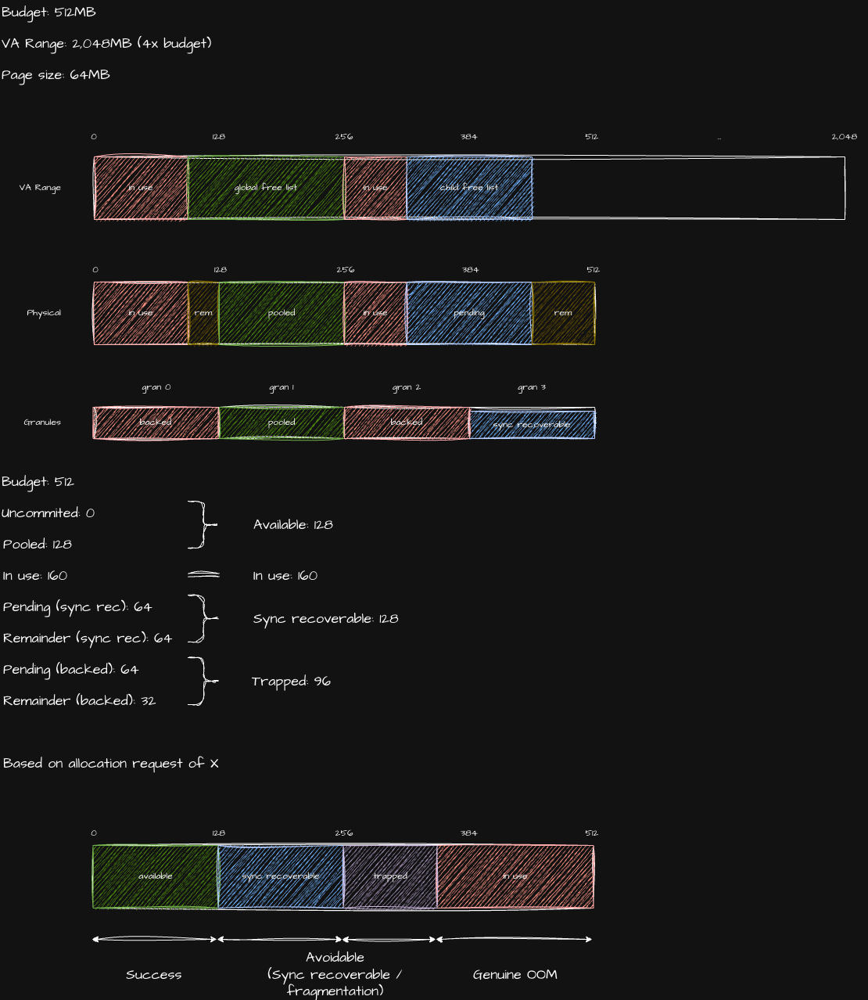

# Memory Manager Overview

The memory manager manages host or device allocated memory. It
grabs chunks of memory from underlying allocators (e.g. CUDA/HIP drivers) and
hands them out to clients as necessary. Host allocated memory here means memory
allocated on the host via the CUDA or HIP drivers. This is often called pinned
memory. Device allocated memory means GPU memory on the device.

## Problem Statement and Motivation

GPU memory allocation through CUDA/HIP APIs (cudaMalloc/hipMalloc) is expensive:

- **System call overhead**: 100-1000μs per allocation vs ~1μs for cache hits
- **GPU memory fragmentation**: Available memory becomes unusable over time
- **Allocation failures**: When memory appears available but is fragmented
- **Synchronization overhead**: Between host and device operations
- **Stream ordering**: Need to respect CUDA/HIP stream dependencies

The MemoryManager solves these problems by:

- **Pre-allocating large chunks**: Reduces expensive CUDA/HIP syscalls
- **Implementing coalescing**: Automatically merges adjacent free blocks to
  reduce fragmentation
- **Hierarchical free lists**: Stream-local caching with fallback to shared
  pools
- **Unified interface**: Supports both host and device memory through the same
  API
- **Stream-aware operations**: Respects asynchronous GPU execution models

## Concepts

- `Chunk` is the unit of memory allocations from the OEM Drivers (eg: via
cudaMallocAsync).

- `Chunk list` is a linked-list of allocated chunks.
- `Block` is an address-range ("buffer") requested by clients of MemoryManager.
MemoryManager sub-divides chunks to form blocks (of allocated memory).
- `Desc`(riptor) is CPU-side metadata describing the block. `Block` is only a
concept - you will not see this in the code (except for comments); it is `Desc`
objects that the MemoryManager tracks.
- `Free list` is a linked list of descriptors for blocks that are not in use and
can be allocated. Such free blocks can be formed either at allocation time when
a chunk or block is split into a used (sub) block (returned) and a free (sub)
block or when previously-used blocks are release. Free-lists form a hierarchy.
The Global (root) free-list has a `NULL` parent and represents free blocks
available DeviceContext-wide. Per-stream free-lists represent blocks that were
previously released by the stream (associated `DeviceBuffer` objects expired)
and can be recycled upon new (in-stream) allocations because the stream
guarantees associated previous ops would have completed. There are separate
free-lists for (on-)**device** memory and (on-)**host** (pinned) memory.
- `Device memory` is on-device memory. For example, "VRAM" in GPUs.
- `Host memory` is a special form of system memory (that we are used to
easily accessing from CPU via pointers) that is pinned to system page-tables
by the Accelerator (e.g. CUDA GPU) drivers. Why do Accelerator drivers pin
memory at all when the host OS (eg. Linux) can do similar (eg: using `mlock()`)?
Because, at the very least, the physical pages selected belong to the same NUMA
domain that the GPU is in, making DMAs efficient (whereas `mlock()` provides no
such guarantee). Such (device-)pinned buffers are very useful as staging areas
for host <--> device copies (DMA). "Host memory" or "pinned memory" are both
ambiguous terms to describe this concept. Something like "Device-Pinned Host
(DPH) Memory" is unambiguous even if long.

## Underlying Memory API Mapping

### CUDA Integration

- **Chunk Allocation**: `cudaMalloc()` for device memory, `cudaMallocHost()` for
  pinned host memory
- **Chunk Deallocation**: `cudaFree()` / `cudaFreeHost()`
- **Memory Info**: `cudaMemGetInfo()` to query available GPU memory for sizing
  decisions
- **Stream Association**: Operations respect CUDA stream ordering for async
  allocations

### HIP Integration

- **Chunk Allocation**: `hipMalloc()` for device memory, `hipHostMalloc()` for
  host memory
- **Chunk Deallocation**: `hipFree()` / `hipHostFree()`
- **Memory Info**: `hipMemGetInfo()` to query available GPU memory
- **Stream Association**: Operations respect HIP stream ordering

### Allocation Modes

- **`SYNC`**: Synchronous allocation (safe for immediate use, may block)
- **`ASYNC`**: Asynchronous allocation (stream-ordered, higher performance)
- **`HOST`**: Host/pinned memory allocation (CPU accessible, GPU transferable)

## Architecture Overview



The source of the above image is available
[here](https://excalidraw.com/#json=fvkxYZNkbOnKZGoYDFvvs,7FnGbaodiDehk0RVWHDlRQ).

### Operation

The memory manager operates on a two-level hierarchy:

1. **MemoryManager**: Owns (relatively large) memory chunks allocated from
   CUDA/HIP
2. **MemoryManagerFreeList**: Manages free blocks within chunks, with hierarchy:
   - **Parent/Shared**: Global free list accessible to all DeviceContexts
   - **DeviceContext-local**: Stream-specific free lists for better cache
     locality

When a block is requested, we first look up free-lists to recycle any
previously-(allocated and) released blocks. If none are available, we allocate
a (new) `Chunk` and split off a block from it (and track its `Desc`riptor).

`Chunk`-s are tracked using a singly-linked list because we just need a way to
invoke the OEM-Driver to (cuda)Free each at the end. This could have been any
other kind of container, like `vector`.

`Desc`-s on the other hand need to be in doubly-linked lists (blue lines)
because of the need to coalesce/defragment. This is done greedily at the time
the `Desc` is merged back into a free-list. The `next` and `prev` pointers in a
`Desc` chain contiguous (in-use or free) blocks within a chunk.

`Desc`-s are also part of a second doubly-linked list (red lines), characterized
by `nextFree` and `prevFree`. These construct the free-list. Blocks may be
released in an order that is different from their allocation-order. Such
releases are chained into the free-list associated with that stream.

### Usage by `DeviceBuffer`

**Allocation**:

`DeviceBuffer` objects are created by calling `DeviceContext::allocBuffer()`.
which in turn calls `MemoryManagerFreeList::allocate()`. This claims blocks from
MemoryManager (free lists). Related `Desc` objects are carved out of free-lists
and placed inside `MemoryManager::allocatedMap_` for efficient pointer-to-`Desc`
lookup during subsequent release. If this `allocate()` fails, the parent
free-list is tried. If the root fails, then we allocate a chunk in the
`MemoryManager` object associated with the `DeviceContext` and retry this
`allocate()`. When all this fails, we declare out-of-memory (OOM).

MemoryManager can be disabled via environment variables (documented below):
all allocations will routed directly to the OEM driver (eg. CUDA).

There are heuristics to grow chunk-sizes when the requested size is larger than
the current chunk size.

**Deallocation**:

When work is asynchronously executing on a device, how will we know when it is
done so that we may recycle the associated blocks (`Desc`) into free-lists?
This is best exemplified in `DeviceBuffer` DTORs. Via
`DeviceContext::setPendingHandler()` API, they create an event on the stream
that last wrote to that DeviceBuffer and associate a CPU-side handler callback.
The could have registered a (CUDA) stream-callback instead but that would
synchronize the stream with the CPU every time such an event fired; this adds
latency. Hence, the design is to call `DeviceContext::pollPendingEvents()` at
various points in the application, which then executes handlers for all "ready"
events (some or all of which are from `~DeviceBuffer()`). These handlers then
invoke `MemoryManagerFreeList::free(ptr)` which retrieves and pops the related
`Desc` from `MemoryManager::allocatedMap_` and then further enqueues a handler
to merge and coalesce free blocks to the parent.

Note that the first level of enqueueing a "DeviceBuffer release" event+handler
is unnecessary if the released `Desc` is going to be reused by the same stream.
Hence, `MemoryManagerFreeList::free(ptr)` is called immediately in this case. It
is for the DPH buffer that the two-level enqueueing is required.

### Example Setup

In the diagram above, we have allocated two chunks of memory with a set of
memory blocks each. A chunk starts with a single large memory block which is
subdivided into multiple blocks as needed to satisfy allocation requests.

There are 5 blocks on the shared MemoryManager free list (aka parent) and 1
block on the MemoryManager free list associated with the stream in the single
(in this example!) DeviceContext.

### Key Components

- **Chunk**: Large memory region allocated from CUDA/HIP (e.g., 256MB)
- **Desc (Descriptor)**: Metadata for each memory block (32-64 bytes overhead)
- **Free Lists**: Multiple sorted lists of available blocks by size
- **DescMap**: Hash table for fast lookup of descriptors by pointer (for free
  operations)

## Usage Scenarios

The following scenarios demonstrate how the memory manager handles different
allocation and deallocation patterns:

### Scenario 1

The DeviceContext releases the memory block `K`. Since all allocations and frees
are streaming we cannot put this block into the shared/parent free list, but
instead it has to be sequestered with blocks used by the DeviceContext's stream:

- Check whether the next and previous blocks in the chunk (`K→next` and
  `K→prev`) are free and if they have the same owner.
- Block `J` satisfies this requirement, so we merge blocks `J` and `K` and add
  the resulting block to the free list associated with the DeviceContext.

### Scenario 2

We want to allocate a new 3MB block on the DeviceContext's stream:

- Check if the free list associated with the DeviceContext contains a block
  greater or equal to 3MB.
- Since we cannot satisfy this, we check whether the parent/shared free list
  satisfies this requirement.
- None of the existing free lists can satisfy the request to allocate 3MB, so we
  end up allocating a new chunk and split the first 3MB off into its own block,
  adding the remainder to the shared free list.

Note: We can only allocate a new chunk if we have not exhausted the maximum
configured size of the memory manager.

### Scenario 3

The block E is freed on a different DeviceContext (not pictured) and added to
the associated free list. At some point in time later, this DeviceContext is
released:

- All free blocks on this DeviceContext's free list are flushed to the parent
  free list, which will merge blocks D, E and F into a single 4.5MB block.

### Scenario 4

We want to allocate a 1.5MB block on the pictured DeviceContext:

- Block J is removed from the DeviceContext's free list.
- The DeviceContext's free list is now empty.

### Scenario 5

We want to allocate a 1.8MB block on the pictured DeviceContext:

- The DeviceContext's free list cannot satisfy this request.
- Find a large enough block on the parent free list identifies block F as
  sufficiently large.
- Remove F from the free list.
- Split the block F into a block F1 (1.8MB) and F2 (0.2MB).
- Add F2 to the shared free list.

## Configuration

### Environment Variables

#### Device Memory Configuration

- **`MODULAR_DEVICE_CONTEXT_MEMORY_MANAGER_SIZE`**: Maximum memory manager size
  in KB (default: uses percentage). A value of 0 disables the memory manager.
- **`MODULAR_DEVICE_CONTEXT_MEMORY_MANAGER_SIZE_PERCENT`**: Percentage of GPU
  memory to use, after the driver has taken its memory (default: 90%). Ignored
  when absolute size (above) is specified. Otherwise, a value of 0 disables the
  memory manager.
- **`MODULAR_DEVICE_CONTEXT_MEMORY_MANAGER_CHUNK_PERCENT`**: Chunk size as
  percentage of max memory manager size (device default: 100%; host default:
  8%). Integer-valued. Must be between 1 and 100; clamped to these limits if
  found to lie outside. A device default of 100% effectively disables
  incremental chunking (the whole pool is one chunk); the smaller host default
  keeps the pinned-memory cache from allocating its full capacity on the first
  allocation.

#### Defragmenting Allocator (CUDA VMM)

The memory manager can back its chunks with CUDA Virtual Memory Management
(VMM) instead of a single contiguous `cuMemAlloc` region. With VMM, chunks are
composed of remappable physical *granules* mapped into reserved virtual
address space. When the free lists cannot satisfy a request because no single
free block is large enough — even though enough memory is free in aggregate
(external fragmentation) — the manager reserves a fresh contiguous virtual
range and maps physically-scattered free granules into it, so the request
succeeds. This eliminates the "plenty free but no contiguous block" OOM.

- **`MODULAR_DEVICE_CONTEXT_MEMORY_MANAGER_VMM`**: Enable the VMM-backed
  defragmenting allocator. **Default: true on NVIDIA GPUs, false elsewhere**
  (HIP/CPU/Metal remain opt-in until they gain production experience). Set to
  `0`/`false` to force the legacy `cuMemAlloc` chunk path, or `1`/`true` to opt
  in on a backend where it is off by default. It auto-disables on devices that
  do not support VMM regardless of this setting. Cross-GPU access is granted
  automatically to every P2P-capable peer (VMM mappings do not inherit
  `cuCtxEnablePeerAccess`).
- **`MODULAR_DEVICE_CONTEXT_MEMORY_MANAGER_VMM_PAGE_MB`**: Physical granule
  (page) size in MiB (default: 256). Rounded up to the device VMM allocation
  granularity; all VMM reservations and the pool/chunk sizes are rounded to a
  multiple of it. Smaller granules reduce internal fragmentation but increase
  the number of physical handles the manager tracks.

#### Host Memory Configuration

- **`MODULAR_DEVICE_CONTEXT_HOST_MEMORY_MANAGER_SIZE`**: Host memory manager
  size in KB
- **`MODULAR_DEVICE_CONTEXT_HOST_MEMORY_MANAGER_CHUNK_PERCENT`**: Host chunk
  percentage

#### Debugging and Testing

- **`MODULAR_DEVICE_CONTEXT_MEMORY_MANAGER_LOG`**: Enable verbose logging
  (default: false)
- **`MODULAR_DEVICE_CONTEXT_MEMORY_MANAGER_SELF_CHECK`**: Enable internal
  consistency checks (default: false)
- **`MODULAR_DEVICE_CONTEXT_MEMORY_MANAGER_ONLY`**: When true, fail on any
  allocation that exceeds memory manager's capacity set via the above variables
  or its constructor API. When false, fall back to allocating from the device
  driver when memory manager is at capacity. The former is useful for
  application-characterization (strict discovery of memory usage). The latter
  is useful in cases where it is not possible to accurately estimate memory
  requirements ahead of time; rather than crashing (think very large models),
  MemoryManager provides "best effort" service and gracefully hands off to
  slower device-driver allocation path at the infrequent extreme. In that sense
  this variable is also a quick relief valve to get more mileage with
  memory-hungry LLM app/services (keep them running while we optimize in the
  background). This variable is ignored when the Memory Manager is
  disabled. Also ignored by the host (pinned) memory manager (i.e. this is
  applicable to accelerator memory only).
- **`MODULAR_DEBUG_DEVICE_ALLOCATOR`**: List of comma separated allocator
  debugging features from the following. The two poison modes are complementary
  tiers and may be combined; see "Poison modes" below.
  - `uninitialized-poison`: fill *graph-tensor* buffers (those allocated via the
    graph driver's `createDeviceMemory`, where the element dtype is known) with
    a **type-aware, non-NaN** sentinel to detect reads of uninitialized data.
    Floating-point buffers get the bit pattern of the largest finite value
    (e.g. `FLT_MAX`) — deliberately non-NaN/non-Inf so it does not conflict with
    the `nan-check` pass when kernels leave allocation padding un-overwritten;
    integer buffers get `0xCD`. Sub-byte floats and all fp8 formats are skipped.
    Detection is via an opt-in Mojo stdlib load check (built with
    `-D MOJO_STDLIB_SIMD_UNINIT_CHECK=true`) that aborts with the offending
    load's source location, dtype, and SIMD lane.
    To poison only some allocations, see [Selecting which allocations to
    poison](#selecting-which-allocations-to-poison).
  - `poison-all`: fill the body of *every* memory-manager allocation (not just
    graph tensors — also internal scratch/workspace and other non-tensor
    buffers) with a single repeated byte on alloc. The allocator layer has no
    dtype information, so this is a **type-agnostic** raw-byte fill; the default
    `0xFF` is a NaN bit pattern for fp32/bf16, so an uninitialized read
    propagates NaN into the output and trips the *existing* differential/
    accuracy tests with no kernel instrumentation required. Because that NaN can
    also surface on legitimately-uninitialized allocation padding, `poison-all`
    can produce `nan-check` false positives and is intended as a manual, opt-in
    debugging aid rather than a CI default. Composes with `out-of-bounds`
    (`poison-all,out-of-bounds`).
  - `out-of-bounds`: enable redzone out-of-bounds write checks see below for
    additional configuration options
- **`MODULAR_DEVICE_CONTEXT_MEMORY_MANAGER_REDZONE_SIZE`**: specify the size in
  bytes of the redzones to be use when
  `MODULAR_DEBUG_DEVICE_ALLOCATOR=out-of-bounds` is enabled
- **`MODULAR_DEVICE_CONTEXT_MEMORY_MANAGER_REDZONE_PATTERN`**: specify the byte
  pattern used to fill the redzones when
  `MODULAR_DEBUG_DEVICE_ALLOCATOR=out-of-bounds` is enabled
- **`MODULAR_DEVICE_CONTEXT_MEMORY_MANAGER_POISON_PATTERN`**: specify the byte
  pattern used to fill allocation bodies when
  `MODULAR_DEBUG_DEVICE_ALLOCATOR=poison-all` is enabled (default: `0xFF`, a
  NaN pattern for fp32/bf16)

#### Poison modes

`uninitialized-poison` and `poison-all` both detect reads of uninitialized
device memory, but at different layers and with opposite trade-offs:

|                        | `uninitialized-poison`                       | `poison-all`                                      |
|------------------------|----------------------------------------------|---------------------------------------------------|
| Layer                  | Graph driver (`createDeviceMemory`)          | Memory allocator (`allocate`)                     |
| Coverage               | Graph tensors only                           | **Every** allocation (incl. scratch)              |
| Sentinel               | Type-aware, **non-NaN** (`FLT_MAX` / `0xCD`) | Raw byte, **NaN** (`0xFF` default)                |
| Detection              | Instrumented Mojo load check → precise abort | NaN propagates into outputs → existing tests fail |
| vs `nan-check`         | Compatible by design                         | May false-positive on un-overwritten padding      |
| Kernel instrumentation | Required (`MOJO_STDLIB_SIMD_UNINIT_CHECK`)   | None                                              |

Use `uninitialized-poison` to pinpoint *which load* read uninitialized tensor
memory. Use `poison-all` as a broad backstop when an uninitialized *internal*
(non-tensor) buffer is corrupting outputs and the tensor-level check does not
cover it. When both are enabled, the allocator fills each block with `0xFF`
first and the graph driver then overwrites graph-tensor bodies with the
type-aware sentinel, so `poison-all` effectively covers the non-tensor
allocations that `uninitialized-poison` cannot see.

#### Selecting which allocations to poison

`uninitialized-poison` fills every graph-tensor allocation by default. To find
which allocation an uninitialized read comes from, restrict it to some
allocations and bisect. Allocations that aren't selected are zero-filled rather
than left alone, so both arms of a bisection stay deterministic.

The following table lists the variables that set the selection:

| Variable                                 | Config key                       | Value                                                   |
|------------------------------------------|----------------------------------|---------------------------------------------------------|
| `MODULAR_DEBUG_ALLOC_POISON_SELECT`      | `debug.alloc_poison_select`      | A selection, fixed for the process                      |
| `MODULAR_DEBUG_ALLOC_POISON_SELECT_FILE` | `debug.alloc_poison_select_file` | A file holding a selection, checked on every allocation |

A selection is either one of these modes on its own:

- `all` (the default): poison every allocation.
- `none`: poison nothing and zero-fill everything.
- `sync-only`: write nothing, but keep the device synchronization after every
  allocation.

Or it's one or both of these filters, joined by `&`, all of which must match:

- `dtype=si64,ui32`: poison only these element types, spelled as `DType` prints
  them.
- `ord=100-2000`: poison only these allocation ordinals, inclusive. `ord=100`
  selects one.

For example, `dtype=si64&ord=100-2000` poisons the `si64` allocations among
ordinals 100 through 2000. The separator is `&` rather than `;` because
`modular.cfg` reads a `;` as the start of a comment. Quote the selection in a
shell.

A malformed clause is ignored with a warning, so a typo widens the selection
instead of narrowing it to nothing and reporting a clean run. A mode combined
with other clauses, or a second `dtype=` or `ord=` filter, counts as malformed.

Each `DEBUG_ALLOC_POISON` log line reports the allocation's ordinal, dtype, and
size, so the log of one run is the index for the next run's `ord=` ranges.
Ordinals line up across runs only if the process allocates in the same order;
diff two runs' logs to check. Ordinals count from the start of the process, or,
with a selection file, from its latest change: each change resets them to zero,
so rewriting the file between two requests addresses "the n-th allocation of
this request" without restarting the server. A change is a new modification
time, size, or file identity. To make sure every rewrite registers, including
one that repeats the same selection, write a temporary file and rename it over
the selection file.

`sync-only` exists because this allocator changes two things at once: it fills
memory, and it synchronizes the device after every allocation. If the output
stays deterministic under `sync-only`, the synchronization is hiding a race. If
it turns nondeterministic again, the fill was doing the work.

Dtypes with no poison pattern (fp8 and sub-byte floats) are left alone when
selected and zero-filled when not. With `poison-all` also enabled, unselected
graph tensors are zero-filled over the allocator's byte pattern.

```bash
export MODULAR_DEBUG_DEVICE_ALLOCATOR=uninitialized-poison
export MODULAR_DEBUG_ALLOC_POISON_SELECT_FILE=/tmp/poison-select
# Before each request, replace the file to set the next selection.
echo 'dtype=si64&ord=100-2000' > /tmp/poison-select.new
mv /tmp/poison-select.new /tmp/poison-select
```

### Configuration Examples

```bash
# Use 75% of GPU memory with 10% chunk size
export MODULAR_DEVICE_CONTEXT_MEMORY_MANAGER_SIZE_PERCENT=75
export MODULAR_DEVICE_CONTEXT_MEMORY_MANAGER_CHUNK_PERCENT=10

# Fixed memory manager size of 1GB
export MODULAR_DEVICE_CONTEXT_MEMORY_MANAGER_SIZE=1048576  # KB

# Enable debugging
export MODULAR_DEVICE_CONTEXT_MEMORY_MANAGER_LOG=true
export MODULAR_DEVICE_CONTEXT_MEMORY_MANAGER_SELF_CHECK=true
```

### Bazel variables

- In `oss/modular/bazel/config.bzl`, the `DEFAULT_GPU_MEMORY` variable lets us
specify, in GB, the default MemoryManager capacity for all tests.

- `oss/modular/bazel/internal/config.bzl`, the `get_default_test_env()` function
uses this value to compute and set various
`MODULAR_DEVICE_CONTEXT_MEMORY_MANAGER_*` environment variables.
- In order to override this per test, follow this example (from
  `docs/internal/BazelBuildFiles.md`):

```bzl
modular_py_test(
    name = "tests_gpu",
    ...
    exec_properties = {
        # Ensure the test has at least 5GB of GPU memory available.
        "test.resources:gpu-memory": "5",
    },
)
```

## Thread Safety and Performance

### Thread Safety

- All operations are protected by internal mutexes (`memoryManager_.mu_`)
- Multiple threads can safely allocate/free concurrently
- Hierarchical free lists provide some thread-local optimization
- Descriptor management is thread-safe with atomic operations where needed

### Performance Characteristics

- **Cache Hit**: ~1μs (pointer arithmetic + list manipulation)
- **Cache Miss (new chunk)**: ~100-1000μs (CUDA/HIP allocation syscall)
- **Fragmentation**: Automatic coalescing reduces fragmentation over time
- **Memory Overhead**: ~32-64 bytes per allocation (descriptor storage)
- **Alignment**: Configurable alignment (minimum 64 bytes) with minimal overhead

### Performance Best Practices

1. **Consistent allocation sizes**: Reduces fragmentation and improves cache hit
   rates
2. **Stream-local DeviceContext**: Use per-stream free lists for better locality
3. **Appropriate chunk sizing**: Balance between memory usage and allocation
   frequency
4. **Monitor cache metrics**: Track hit rates and fragmentation in production
5. **Batch operations**: Group small allocations when possible

## Code Usage Examples

### Basic Allocation Pattern

```cpp
// Get free list from device context
MemoryManagerFreeList* freeList = deviceContext->freeList();

// Allocate buffer
ErrorOr<void*> ptrResult = freeList->allocate(1024, Device::AllocMode::SYNC);
if (ptrResult.isError()) {
    // Handle allocation failure - may fallback to direct device allocation
    handleError(ptrResult.takeError());
}

void* ptr = ptrResult.takeValue();
// Use the buffer...
useBuffer(ptr);

// Free when done (critical for cache efficiency)
ErrorOrSuccess freeResult = freeList->free(ptr);
if (freeResult.isError()) {
    handleError(freeResult.takeError());
}
```

### Stream-Ordered Allocation (Recommended)

```cpp
// Allocate asynchronously on stream - more efficient
ErrorOr<DeviceBufferRef> buffer = deviceContext->enqueueCreateBuffer(1024);
if (buffer.isError()) {
    handleError(buffer.takeError());
}

// Buffer is ready after stream synchronization
deviceContext->synchronize();
// Buffer automatically freed when DeviceBufferRef goes out of scope
```

### Host Buffer Allocation

```cpp
// Create host-accessible buffer for CPU/GPU transfers
ErrorOr<DeviceBufferRef> hostBuffer = deviceContext->createHostBuffer(1024);
if (!hostBuffer.isError()) {
    void* hostPtr = hostBuffer.takeValue()->ptr();
    // Can directly read/write from CPU
    memcpy(hostPtr, sourceData, 1024);
    // Can also be used in GPU operations
}
```

## Debugging and Troubleshooting

### Common Issues

1. **Out of Memory Errors**
   - Check `memory_manager_size_percent` setting
   - Monitor GPU memory usage with `nvidia-smi` / `rocm-smi`
   - Verify application isn't leaking buffers (missing `free()` calls)

2. **Memory Fragmentation**
   - Enable logging to analyze allocation patterns
   - Reduce allocation size variance
   - Consider larger chunk sizes for workloads with many small allocations

3. **Poor Performance**
   - Profile cache hit rates with logging enabled
   - Adjust chunk percentage based on allocation patterns
   - Check for excessive allocation/free churn

### Interpreting VMM Out-of-Memory Errors

When the VMM allocator cannot satisfy a request, the error names a category
in parentheses, explains it, and ends with a bracketed accounting snapshot:

```text
Memory manager cannot satisfy allocation (avoidable): cuda[0] on [freeList]@0x...:
requested 320MB, 128MB allocatable. Not an exhaustion: the shortfall is covered
by up to 128MB that synchronizing would free (128MB pending in total) and up to
96MB trapped in partially-used 64MB pages, which lowering
memory_manager_vmm_page_mb may recover [vmm_oom requested=320MB ...]
```

The diagram below shows the allocator state behind that message: a 512MB
budget with 64MB pages and a 4x VA reservation. It breaks the budget down into
available, sync-recoverable, trapped and in-use memory, and shows which
category a request of a given size falls into.



If the request also fell through to the device driver and failed there, the
driver's error is appended as `direct device allocation also failed: ...`. The
manager's category comes first because it is the part that tells you what to
change.

| Category                       | Meaning                                                                                                                                                                                                                         | What to try                                                                                                                           |
|--------------------------------|---------------------------------------------------------------------------------------------------------------------------------------------------------------------------------------------------------------------------------|---------------------------------------------------------------------------------------------------------------------------------------|
| `out of memory`                | The budget is exhausted. Synchronizing and a smaller page size together would not free enough.                                                                                                                                  | Reduce memory use (batch size, KV cache, and so on) or raise the budget (`MODULAR_DEVICE_CONTEXT_MEMORY_MANAGER_SIZE_PERCENT`).       |
| `avoidable`                    | The memory exists but is unusable right now. It is either *pending* (freed on a stream, waiting for the stream to finish) or *trapped* (free bytes in pages that also hold live allocations). The message reports both amounts. | For pending memory, synchronize before the allocation. For trapped memory, lower `MODULAR_DEVICE_CONTEXT_MEMORY_MANAGER_VMM_PAGE_MB`. |
| `unaccounted`                  | The manager expected to succeed, but the driver refused. Something outside the manager holds the memory, such as another process or context on the device, or a direct driver allocation.                                       | Check `nvidia-smi` for other consumers, and lower the budget percentage to leave room for them.                                       |
| `VA fragmentation`             | There is enough physical memory, but no contiguous virtual address range is large enough.                                                                                                                                       | Raise `MODULAR_DEVICE_CONTEXT_MEMORY_MANAGER_VMM_VA_FACTOR` (default 4: the reserved VA is 4x the budget).                            |
| `arena unavailable`            | The VMM arena was never reserved, so nothing can be allocated. The reservation error, if any, is appended.                                                                                                                      | Look at the appended reservation error. This is a setup failure, not memory pressure.                                                 |
| `illegal during graph capture` | During a graph capture, a request landed in memory that was not backed before the capture began. Mapping is illegal mid-capture.                                                                                                | The capture needs more memory than was free when it started. Reduce allocations inside the capture, or free memory before capturing.  |

The snapshot fields, in bytes unless noted:

- `budget`, `used`: the manager's budget and the bytes under live allocations.
- `available`: what can be allocated immediately (whole free pages, pooled
  pages, and budget not yet committed).
- `recoverable_by_sync`: whole pages that hold only pending frees.
  `pending_total` counts all pending bytes, including ones in pages that also
  hold live allocations, which synchronizing alone cannot recover.
- `trapped`: free or pending bytes in pages that also hold live allocations.
  Only a smaller page size recovers them.
- `largest_root_free_va`, `va_size`: the largest contiguous free virtual range
  and the size of the whole reservation.
- `page_counts[...]`: the budget's pages (counts, not bytes) by state:
  `in_use`, `pending`, `reclaimable` (backed and free), `pooled` (created but
  unmapped), and `uncommitted` (not yet created).

`recoverable_by_sync` and `trapped` are upper bounds. Whether a recovered page
helps also depends on where the request lands, so treat them as suggestions,
not guarantees.

### Debugging Tools

```bash
# Enable verbose logging
export MODULAR_DEVICE_CONTEXT_MEMORY_MANAGER_LOG=true

# Enable self-checks (debug builds only)
export MODULAR_DEVICE_CONTEXT_MEMORY_MANAGER_SELF_CHECK=true

# Force memory-manager-only mode (testing fragmentation)
export MODULAR_DEVICE_CONTEXT_MEMORY_MANAGER_ONLY=true
```

### Log Output Format

When logging is enabled, you'll see output like:

```bash
##(CUDA[0]:0x12345)##: memory_manager(chunk_size: 268435456 ; max_cache_size: 1073741824 ; free_list: 0x67890)
##(CUDA[0]:0x12345)##: allocate_chunk(0x7f8b4c000000 ; 268435456)
##(CUDA[0]:0x12345)##: allocate on 0x67890 from free buffer at id: 0 (0x7f8b4c001000 ; 1024), 3, -1024
##(CUDA[0]:0x12345)##: free on 0x67890 (0x7f8b4c001000 ; 1024), 0, 1024
##(CUDA[0]:0x12345)##: mergeFreeBlockDesc(0x7f8b4c001000 ; 1024) - (merge next)
```

Key log entries:

- **memory_manager**: Initial configuration
- **allocate_chunk**: New chunk allocated from CUDA/HIP
- **allocate on**: Cache hit (fast path)
- **free on**: Block returned to cache
- **mergeFreeBlockDesc**: Automatic defragmentation

### Memory Leak Detection

The memory manager includes built-in leak detection:

- Descriptors track allocation state
- Self-check mode validates free list consistency
- Destructor asserts all memory is properly freed

### Performance Profiling

Monitor these metrics in production:

- **Cache hit rate**: Should be >90% for well-tuned applications
- **Average allocation size**: Should align with chunk sizing
- **Fragmentation ratio**: Available memory vs largest free block
- **Chunk utilization**: Percentage of allocated chunks actively used

## Developer Notes

- `MemoryManager` was originally called `BufferCache`.

- `MemoryManager::DescMap` is basically just a hash-map. It could have been a
  `std::unordered_map`, but the custom implementation lets each `Desc` carry its
  own `nextMap_` chaining pointer, so insert and remove reuse `Desc` objects
  drawn from the manager's descriptor pool instead of allocating map nodes on
  the heap. That avoids calling `malloc`/`free` while holding the manager's lock
  on every allocation. `DescMap` has no locking of its own; all access is
  serialized under the single global `MemoryManager::mu_`.
- The MemoryManager feature looks a lot like CUDA's mempools but in early
experiments we found ~10% gains from such application-space memory pool
management so we built this.
  - It may still be useful for Accelerators that do not provide native memory
  pooling.
- The first implementation of `MemoryManager` had no concept of `Chunk`; it
claimed its capacity in a single shot from the OEM driver in its CTOR. When its
capacity was expressed in relative measure (eg. default of 90% (of available
device memory!)), it left no room to run other applications (eg: packing
multiple tests per node for CI/CD efficiency). Chunking was then introduced as a
way to gently grow allocations based on actual demand even if its capacity was
estimated very loosely.
[CI/CD has been using `chunk-percent`=100](https://modular-ai.slack.com/archives/C05M07LTK0V/p1767836840942569?thread_ts=1767834473.328959&cid=C05M07LTK0V)
for a while now and effective turns off chunking so we now retain it to control
memory pressure. We expect use-cases like PyTorch inter-op to benefit from this.
- Each `MemoryManagerFreeList` is internally implemented with "multi-buffering";
there actually are more-than-1 such physical lists that we interact with on
round-robin basis. This avoids one free list being starved when allocations are
moved from one device context to another.
