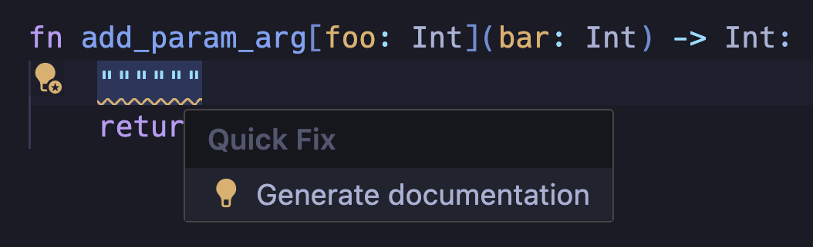

# Coding standards & style guide

This document describes conventions that Mojo standard library code should
adhere to. Its coverage ranges from non-semantic conventions like code
formatting, to semantics like value lifecycle behavior that standard library
types should generally conform to.

## Structure and formatting

### Files & layout

#### File structure

The Mojo standard library uses the following high-level organization:

- Group related functions within the same file.
- Group related files within the same directory.
- Do not add dependencies to the `std` package because, by definition, it is
required to be a leaf dependency.

```text
> stdlib               # stdlib root directory
    > benchmarks       # stdlib benchmarks
    > scripts          # stdlib developer scripts
    > std              # stdlib mojo source files
        > builtin      # mojo source for stdlib builtins
        > collections  # mojo source for stdlib collections
        > memory       # mojo source for stdlib memory primitives
        ...
    > test             # stdlib unit tests
    > tools            # stdlib developer tools
```

All Mojo source files must end with the extension `.mojo`.

#### Mojo format

Mojo provides a command line formatting utility, `mojo format`, designed to
automatically format your code according to the official Mojo style guidelines.
It adjusts indentation, spacing, and line breaks, making code more readable and
consistent.

```bash
> mojo format example.mojo
All done! ✨ 🍰 ✨
1 file left unchanged.
```

Unless otherwise noted, Mojo standard library code should follow the formatting
produced by `mojo format`. To format your changes automatically at each commit,
set up the `pre-commit` hook described in
[Formatting changes](stdlib-development.md#formatting-changes).

#### API docstring validation

Mojo provides a command line utility, `mojo doc`, to validate the API doc
strings in your code. This ensures that your doc strings are correctly
formatted and consistent with the Mojo style guidelines.
Note that you should not have any warnings.

```bash
mojo doc --diagnose-missing-doc-strings -Werror -o /dev/null stdlib/std/
```

#### Whitespace

- Use vertical whitespace only as needed to organize code into logical sections.

#### File license header

Every file in the open source Mojo standard library should begin with the
following license information header:

```mojo
# ===----------------------------------------------------------------------=== #
# Copyright (c) 2026, Modular Inc. All rights reserved.
#
# Licensed under the Apache License v2.0 with LLVM Exceptions:
# https://llvm.org/LICENSE.txt
#
# Unless required by applicable law or agreed to in writing, software
# distributed under the License is distributed on an "AS IS" BASIS,
# WITHOUT WARRANTIES OR CONDITIONS OF ANY KIND, either express or implied.
# See the License for the specific language governing permissions and
# limitations under the License.
# ===----------------------------------------------------------------------=== #
```

#### Code header comments

Code in the Mojo standard library should use the following conventional
structure of header comments separating the various kinds of methods that can be
defined on structs.

```mojo
# ===-----------------------------------------------------------------------===#
# MyStruct
# ===-----------------------------------------------------------------------===#


struct MyStruct(Sized, Writable):
    """Description goes here."""

    # ===-------------------------------------------------------------------===#
    # Comptime members
    # ===-------------------------------------------------------------------===#

    comptime factor = 5

    # ===-------------------------------------------------------------------===#
    # Fields
    # ===-------------------------------------------------------------------===#

    var field: Int

    # ===-------------------------------------------------------------------===#
    # Life cycle methods
    # ===-------------------------------------------------------------------===#

    def __init__(...)
    def __init__(out self, *, copy: Self)
    def __init__(out self, *, deinit move: Self)

    def __deinit__(...)

    # ===-------------------------------------------------------------------===#
    # Factory methods
    # ===-------------------------------------------------------------------===#

    @staticmethod
    def foo(...) -> Self[...]

    # ===-------------------------------------------------------------------===#
    # Operator dunders
    # ===-------------------------------------------------------------------===#

    # Anything that "backs" special syntax: [..], *, +, /, //, etc...

    def __getitem__
    def __setitem__

    def __getattr__
    def __setattr__

    def __iter__     # `for x in self`
    def __next__
    def __contains__ # `x in self`
    def __is__       # `x is self`

    def __add__
    def __iadd__

    # ===-------------------------------------------------------------------===#
    # Trait implementations
    # ===-------------------------------------------------------------------===#

    def __bool__
    def __len__

    def __abs__

    def write_to
    def write_repr_to

    # ===-------------------------------------------------------------------===#
    # Methods
    # ===-------------------------------------------------------------------===#

    def unsafe_ptr(..)   # e.g.
```

## Code conventions

### Identifier naming conventions

There are several ways to capitalize and separate words, known as "case
styles." By following the same set of case styles in our code, Mojo developers
ensure their code is accessible and understandable to others in the community.

This first table is just a definition of the various "case styles."

| Case style             | Description                               | Example          |
|------------------------|-------------------------------------------|------------------|
| `snake_case`           | All lowercase with underscores            | `variable_name`  |
| `PascalCase`           | Each word starts with an uppercase letter | `StructName`     |
| `SCREAMING_SNAKE_CASE` | All uppercase with underscores            | `CONSTANT_VALUE` |
| `kebab-case`           | All lowercase with hyphens                | `project-name`   |
| `flatcase`             | All lowercase without separators          | `basename`       |

The following table shows our preferred use of different case styles.

| Code kind                         | Example                                                 | Case style                            |
|-----------------------------------|---------------------------------------------------------|---------------------------------------|
| `def`                             | `def engage_hyperdrive()`                               | `snake_case`                          |
| `struct`                          | `struct Point`                                          | `PascalCase`                          |
| `trait`                           | `trait Copyable`                                        | `PascalCase`                          |
| `__enum`                          | `__enum StatusCode`                                     | `PascalCase`                          |
| `var`                             | `var the_value = 5`                                     | `snake_case`                          |
| `module` / `package`              | `io.mojo` / `os/__init__.mojo`                          | `flatcase` / `snake_case`             |
| dunder                            | `__init__`                                              | `flatcase`                            |
| decorator                         | `@inline(.never)`                                       | `snake_case`                          |
| **Parameters — type or value**    | &nbsp;                                                  | &nbsp;                                |
| `comptime` type                   | `comptime Int8 = Scalar[DType.int8]`                    | `PascalCase`                          |
| `comptime` value (global / local) | `comptime CHUNK_SIZE = 32` / `comptime chunk_size = 32` | `SCREAMING_SNAKE_CASE` / `snake_case` |
| `struct` type parameter           | `struct List[ElementType: Movable]`                     | `PascalCase`                          |
| `struct` value parameter          | `struct Array[ElementType: Movable, length: Int]`       | `snake_case`                          |
| `def` type parameter              | `def do_it[Action: Actionable](action: Action)`         | `PascalCase`                          |
| `def` value parameter             | `def repeat[count: Int]()`                              | `snake_case`                          |

Although these are our style conventions, not all code currently adheres to it.
When preparing a new change, it is important to adhere to the style and naming
conventions already established in that module. Therefore, if the module you
are working on uses a different style, continue using that style to maintain
consistency. We are not currently accepting pull requests that propose
extensive formatting or renaming changes.

### Naming guidelines

#### ℹ️ Prefer descriptive parameter names over single-letter names

```mojo
struct LinkedList[T: Movable]           # 🔴 Avoid
struct LinkedList[ElementType: Movable] # 🟢 Preferred
```

#### ℹ️ Order type parameters ahead of value parameters

```mojo
struct Array[length: Int, ElementType: Movable] # 🔴 Avoid
struct Array[ElementType: Movable, length: Int] # 🟢 Preferred
```

#### Use the `Some[]` utility instead of named type parameters when appropriate

Consider using the `Some[]` utility if a named (and inferred) type parameter
is not reused in a function signature or body.

```mojo
def foo[Str: Writable, //](arg: Str): ... # 🔴 Avoid
def foo(arg: Some[Writable]): ...         # 🟢 Preferred
```

Avoid using the `Some[]` utility if a named type parameter is reused in a
function signature or body.

```mojo
def foo(arg0: Some[Writable], arg1: type_of(arg0)): ... # 🔴 Avoid
def foo[Str: Writable, //](arg0: Str, arg1: Str): ...     # 🟢 Preferred
```

### Container lifecycle semantics

#### ℹ️ Prefer explicit copy constructors; avoid allowing implicit copies

```mojo
var copy = original                 # 🔴 Avoid
var copy = MyStruct(copy=original)  # 🟢 Preferred
```

Where you intend to make a copy, favor an explicit copy constructor to make your
intention clear.

Copying types that conform to `RegisterPassable` like `Int`, `Bool`, `Pointer`,
and `SIMD` is
safe and inexpensive. However, copying types that dynamically allocate memory
can be expensive. This includes common types like `List`, `Dict`, `Set`,
and `String`.

Some standard library types allow implicit copies where they shouldn’t. We will
resolve this shortly as new Mojo language features are shipped to help with this
very situation.

When designing a new type, don’t allow implicit copies unless
the copy is trivial (order `O(1)`). In other words, just conform to `Copyable`
but not `ImplicitlyCopyable`.

### Import statements

- Explicitly import entities used (functions, structs, `comptime`
  declarations), rather than rely on transitive imports.
- Import only what you use; in general, avoid using
  `from some_package import *`.
- Import standard library modules through the `std` package, for example
  `from std.collections import Deque`.
- Import statements should be sorted lexicographically.

### API docstrings

Every public function and public struct (including data fields) in the standard
library must have docstrings (code comments that describe the API behavior).
The LSP warns about missing or malformed docstrings, and you can generate a
docstring based on the signature using an LSP Quick Fix:



To validate docstrings from the command line, see
[API docstring validation](#api-docstring-validation). For the full set of
docstring conventions, see the
[Mojo docstring style guide](docstring-style-guide.md).

### Assertions

You should use assertions liberally when there is a condition you expect for the
following code to behave correctly. Assertions may be present even in
"unsafe" methods and types. You should format the message to be descriptive with
the expected and actual values:

```mojo
var actual = 41
var expected = 42
debug_assert(actual == expected, "expected: ", expected, " but got: ", actual)
```

Make sure that you don't allocate anything in the call to `debug_assert` to
ensure there is no runtime penalty when assertions are disabled. If you must
have a side-effect in the condition such as allocating a `List`, you can pass
a closure that only runs when assertions are enabled:

```mojo
def binary_search(items: List[Int], target: Int) -> Int:
    def is_sorted() {items} -> Bool:
        var sorted_items = items.copy()
        sort(sorted_items)
        return sorted_items == items

    debug_assert(is_sorted, "`binary_search` requires sorted input")
    ...
```

### Target-specific code

When writing code that uses `comptime if` to tailor logic based on the target
hardware platform or features, do not use trailing `else` statements that
"fallthrough" to a particular hardware vendor.

This leads to poor error messages when an unsupported hardware vendor is
targeted.

```mojo
# 🔴 Avoid
comptime if is_nvidia_gpu():
    return "llvm.nvvm..."
else:
    # BAD: Assumes only non-NVIDIA target is AMD
    return "llvm.amdgcn..."
```

Always gate hardware-specific logic on an explicit check that the vendor or
feature is being targeted:

```mojo
# 🟢 Prefer

comptime if is_nvidia_gpu():
    ...
elif is_amd_gpu():
    ...
else:
    CompilationTarget.unsupported_target_error()
```

In cases where a generic, cross-platform compatible fallback implementation
is available, it is okay to use an unguarded `else` condition:

```mojo
@inline(.nodebug)
def prefetch[...](...):
    comptime if is_nvidia_gpu():
        inlined_assembly["prefetch.global.L2 [$0];", ...](...)
    else:
        llvm_intrinsic["llvm.prefetch", NoneType](...)
```

### Testing

#### Unit test filenames

All test filenames should be prefixed with `test_`.
For example `test_sort.mojo`.

#### Test organization

- Tests should mirror the source structure
  - e.g., `std/collections/list.mojo` tests are in
  `test/collections/test_list.mojo`
- Use the `testing` module assertions (`assert_equal`, `assert_true`, etc.) for
  new tests
- Test files should focus on testing the public API and critical edge cases

Each test file runs its tests from a `main` function that uses `TestSuite`:

```mojo
from std.testing import assert_equal, TestSuite


def test_sort() raises:
    var items = [3, 1, 2]
    sort(items)
    assert_equal(items, [1, 2, 3])


def main() raises:
    TestSuite.discover_tests[__functions_in_module()]().run()
```

#### Performance tests and benchmarks

- Benchmarks are located in the `benchmarks/` directory
- Use the `benchmark` module for performance testing
- Benchmark files should be prefixed with `bench_` (e.g., `bench_sort.mojo`)

#### Integration with build system

- See the
  [bazel usage docs](https://github.com/modular/modular/blob/main/bazel/docs/usage.md)
  for more details on how to run tests.
