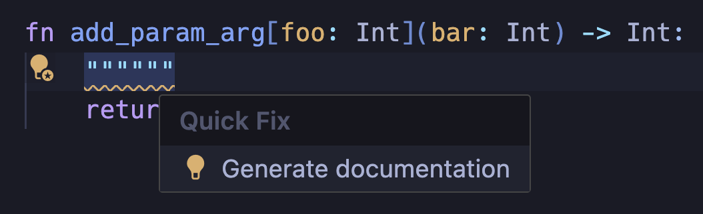

# Coding standards & style guide

This document describes conventions that Mojo standard library code should
adhere to. Its coverage ranges from non-semantic conventions like code
formatting, to semantics like value lifecycle behavior that standard library
types should generally conform to.

## Structure and formatting

### Files & layout

#### File structure

The Mojo standard library uses the following high-level organization:

- Group related functions within the same file.
- Group related files within the same directory.
- Do not add dependencies to the `std` package because, by definition, it is
required to be a leaf dependency.

```text
> stdlib               # stdlib root directory
    > benchmarks       # stdlib benchmarks
    > scripts          # stdlib developer scripts
    > std              # stdlib mojo source files
        > builtin      # mojo source for stdlib builtins
        > collections  # mojo source for stdlib collections
        > memory       # mojo source for stdlib memory primitives
        ...
    > test             # stdlib unit tests
    > tools            # stdlib developer tools
```

All Mojo source files must end with the extension `.mojo`.

#### Mojo format

Mojo provides a command line formatting utility, `mojo format`, designed to
automatically format your code according to the official Mojo style guidelines.
It adjusts indentation, spacing, and line breaks, making code more readable and
consistent.

```bash
> mojo format example.mojo
All done! ✨ 🍰 ✨
1 file left unchanged.
```

Unless otherwise noted, Mojo standard library code should follow the formatting
produced by `mojo format`. To format your changes automatically at each commit,
set up the `pre-commit` hook described in
[Formatting changes](stdlib-development.md#formatting-changes).

#### API docstring validation

Mojo provides a command line utility, `mojo doc`, to validate the API doc
strings in your code. This ensures that your doc strings are correctly
formatted and consistent with the Mojo style guidelines.
Note that you should not have any warnings.

```bash
mojo doc --diagnose-missing-doc-strings -Werror -o /dev/null stdlib/std/
```

#### Whitespace

- Use vertical whitespace only as needed to organize code into logical sections.

#### File license header

Every file in the open source Mojo standard library should begin with the
following license information header:

```mojo
# ===----------------------------------------------------------------------=== #
# Copyright (c) 2026, Modular Inc. All rights reserved.
#
# Licensed under the Apache License v2.0 with LLVM Exceptions:
# https://llvm.org/LICENSE.txt
#
# Unless required by applicable law or agreed to in writing, software
# distributed under the License is distributed on an "AS IS" BASIS,
# WITHOUT WARRANTIES OR CONDITIONS OF ANY KIND, either express or implied.
# See the License for the specific language governing permissions and
# limitations under the License.
# ===----------------------------------------------------------------------=== #
```

#### Code header comments

Code in the Mojo standard library should use the following conventional
structure of header comments separating the various kinds of methods that can be
defined on structs.

```mojo
# ===-----------------------------------------------------------------------===#
# MyStruct
# ===-----------------------------------------------------------------------===#


struct MyStruct(Sized, Writable):
    """Description goes here."""

    # ===-------------------------------------------------------------------===#
    # Comptime members
    # ===-------------------------------------------------------------------===#

    comptime factor = 5

    # ===-------------------------------------------------------------------===#
    # Fields
    # ===-------------------------------------------------------------------===#

    var field: Int

    # ===-------------------------------------------------------------------===#
    # Life cycle methods
    # ===-------------------------------------------------------------------===#

    def __init__(...)
    def __init__(out self, *, copy: Self)
    def __init__(out self, *, deinit move: Self)

    def __deinit__(...)

    # ===-------------------------------------------------------------------===#
    # Factory methods
    # ===-------------------------------------------------------------------===#

    @staticmethod
    def foo(...) -> Self[...]

    # ===-------------------------------------------------------------------===#
    # Operator dunders
    # ===-------------------------------------------------------------------===#

    # Anything that "backs" special syntax: [..], *, +, /, //, etc...

    def __getitem__
    def __setitem__

    def __getattr__
    def __setattr__

    def __iter__     # `for x in self`
    def __next__
    def __contains__ # `x in self`
    def __is__       # `x is self`

    def __add__
    def __iadd__

    # ===-------------------------------------------------------------------===#
    # Trait implementations
    # ===-------------------------------------------------------------------===#

    def __bool__
    def __len__

    def __abs__

    def write_to
    def write_repr_to

    # ===-------------------------------------------------------------------===#
    # Methods
    # ===-------------------------------------------------------------------===#

    def unsafe_ptr(..)   # e.g.
```

## Code conventions

### Identifier naming conventions

There are several ways to capitalize and separate words, known as "case
styles." By following the same set of case styles in our code, Mojo developers
ensure their code is accessible and understandable to others in the community.

This first table is just a definition of the various "case styles."

| Case style             | Description                               | Example          |
|------------------------|-------------------------------------------|------------------|
| `snake_case`           | All lowercase with underscores            | `variable_name`  |
| `PascalCase`           | Each word starts with an uppercase letter | `StructName`     |
| `SCREAMING_SNAKE_CASE` | All uppercase with underscores            | `CONSTANT_VALUE` |
| `kebab-case`           | All lowercase with hyphens                | `project-name`   |
| `flatcase`             | All lowercase without separators          | `basename`       |

The following table shows our preferred case style for each kind of name. For
a kind of name that the table doesn't list, follow the style of the surrounding
code.

| Code kind                                    | Example                                    | Case style   |
|----------------------------------------------|--------------------------------------------|--------------|
| `trait`                                      | `trait Copyable`                           | `PascalCase` |
| Trait composition                            | `comptime KeyElement = Movable & Hashable` | `PascalCase` |
| `struct` type                                | `struct Point`                             | `PascalCase` |
| `__enum` type                                | `__enum IOErrorKind` / `__enum IpAddr`     | `PascalCase` |
| `__enum` case                                | `case not_found`                           | `snake_case` |
| Module-level `comptime` type alias           | `comptime Int8 = Scalar[DType.int8]`       | `PascalCase` |
| Type parameter                               | `struct List[T: Movable]`                  | `PascalCase` |
| Value parameter                              | `def repeat[count: Int]()`                 | `snake_case` |
| Origin parameter                             | `struct CStringSpan[origin: ImmOrigin]`    | `snake_case` |
| Function or method                           | `def engage_hyperdrive()`                  | `snake_case` |
| Field                                        | `var capacity: Int`                        | `snake_case` |
| Argument                                     | `def engage_hyperdrive(warp_factor: Int)`  | `snake_case` |

Although these are our style conventions, not all code currently adheres to it.
Any newly added Mojo code, however, should adhere to the style conventions.

#### Exceptions

C FFI binding code can use the exact C spelling of a name instead of the case
style in the table. Matching the C name keeps the binding easy to compare with
the C headers and documentation. For example:

- A struct: `struct sockaddr_in`
- A `typedef`: `comptime sa_family_t = c_ushort`
- A constant: `comptime SOCK_CLOEXEC: c_int = 0o2000000`
- An enum value: `comptime PyGILState_LOCKED = c_int(0)`

### Naming guidelines

#### ℹ️ Use conventional short type parameter names unless they hurt readability

Type parameter names use `PascalCase`. When the role of a type parameter is
clear, use a short conventional name:

- `T`, `U`, `V`: general types, such as the element type of a collection.
- `Ts`: a variadic type parameter pack.
- `K` and `V`: the key and value types of a key-value collection.
- `E`: an error type.

```mojo
struct List[ElementType: Movable]                    # 🔴 Avoid
struct List[T: Movable]                              # 🟢 Preferred

struct Dict[KeyType: KeyElement, ValueType: Movable] # 🔴 Avoid
struct Dict[K: KeyElement, V: Movable]               # 🟢 Preferred
```

When a declaration has several type parameters and short names make their roles
hard to tell apart, use descriptive names such as `ErrorType` or `Element`.

```mojo
struct Codec[T: Movable, U: Movable, V: Writer]                # 🔴 Avoid
struct Codec[Decoded: Movable, Encoded: Movable, Sink: Writer] # 🟢 Preferred
```

#### ℹ️ Order type parameters ahead of value parameters

```mojo
struct Array[length: Int, T: Movable] # 🔴 Avoid
struct Array[T: Movable, length: Int] # 🟢 Preferred
```

#### Use the `Some[]` utility instead of named type parameters when appropriate

Consider using the `Some[]` utility if a named (and inferred) type parameter
is not reused in a function signature or body.

```mojo
def foo[Str: Writable, //](arg: Str): ... # 🔴 Avoid
def foo(arg: Some[Writable]): ...         # 🟢 Preferred
```

Avoid using the `Some[]` utility if a named type parameter is reused in a
function signature or body.

```mojo
def foo(arg0: Some[Writable], arg1: type_of(arg0)): ... # 🔴 Avoid
def foo[Str: Writable, //](arg0: Str, arg1: Str): ...     # 🟢 Preferred
```

### Container lifecycle semantics

#### ℹ️ Copy with `copy()`; avoid allowing implicit copies

```mojo
var copy = MyStruct(copy=original)  # 🔴 Avoid
var copy = original.copy()          # 🟢 Preferred
```

When you intend to copy a value whose type doesn't conform to
`ImplicitlyCopyable`, call its `copy()` method. The `Copyable` trait provides
`copy()`, so the call reads the same for every type and doesn't repeat the type
name.

Types that conform to `TrivialRegisterPassable`, such as `Int`, `Bool`, `SIMD`,
and `Pointer`, are implicitly copyable and inexpensive to copy. Copying a type
that owns heap memory, such as `List`, `Dict`, or `Set`, allocates memory and
copies every element, so these types require an explicit `.copy()`.

When designing a new type, don't allow implicit copies unless the copy is
trivial (order `O(1)`). In other words, conform to `Copyable` but not
`ImplicitlyCopyable`. `String` is an example of the exception: a copy only
increments a reference count, so `String` is `ImplicitlyCopyable`.

### String formatting

#### ℹ️ Use t-strings instead of variadic `Writable` arguments

To build a message from several values, write a t-string (`t"..."`) instead of
passing the pieces as separate arguments. A t-string reads like the message it
produces.

```mojo
raise Error("expected ", expected, " but got ", actual) # 🔴 Avoid
raise Error(t"expected {expected} but got {actual}")    # 🟢 Preferred
```

### Pattern matching

#### ℹ️ Use `match` instead of an `if`/`elif` chain over one value

When several branches test the same value, write a `match`. Each `case` names
one alternative, and `|` combines alternatives that share a body. For a
parameter, use `comptime match` to dispatch at compile time. Keep `if`/`elif`
when the conditions test unrelated expressions.

```mojo
# 🔴 Avoid
if dtype == .float32:
    return 4
elif dtype == .float16 or dtype == .bfloat16:
    return 2
else:
    return 1

# 🟢 Prefer
match dtype:
    case .float32:
        return 4
    case .float16 | .bfloat16:
        return 2
    case _:
        return 1
```

#### ℹ️ Unwrap an `Optional` with a pattern instead of `value()`

Don't test an `Optional` and then call `value()` or `unsafe_value()`. A pattern
tests and binds in one step, so the payload can't be read when it's absent.
Choose the form by what the code does when the value is absent:

- It uses a default: `opt.or_else(default)`.
- It leaves the scope with `return`, `raise`, `continue`, `break`, or
  `abort()`: `__guard case .Some(x) = opt else:`. The binding `x` stays in
  scope after the statement, so the main path keeps its indentation.
- It uses the payload only when it's present: `if case .Some(x) = opt:`.
- Both cases do work and continue: `match opt:` with `.Some(x)` and `.None`
  cases.

When the value can't be absent, write
`__guard case .Some(x) = opt else: abort("<reason>")` so the code states the
invariant where it relies on it.

```mojo
# 🔴 Avoid
if not opt:
    return -1
use(opt.value())

# 🟢 Prefer
__guard case .Some(x) = opt else:
    return -1
use(x)
```

```mojo
var n = opt.value() if opt else 0 # 🔴 Avoid
var n = opt.or_else(0)            # 🟢 Preferred
```

### Import statements

- Explicitly import entities used (functions, structs, `comptime`
  declarations), rather than rely on transitive imports.
- Import only what you use; in general, avoid using
  `from some_package import *`.
- Import standard library modules through the `std` package, for example
  `from std.collections import Deque`.
- Import statements should be sorted lexicographically.

### API docstrings

Every public function and public struct (including data fields) in the standard
library must have docstrings (code comments that describe the API behavior).
The LSP warns about missing or malformed docstrings, and you can generate a
docstring based on the signature using an LSP Quick Fix:



To validate docstrings from the command line, see
[API docstring validation](#api-docstring-validation). For the full set of
docstring conventions, see the
[Mojo docstring style guide](docstring-style-guide.md).

### Assertions

You should use assertions liberally when there is a condition you expect for the
following code to behave correctly. Assertions may be present even in
"unsafe" methods and types. You should format the message to be descriptive with
the expected and actual values:

```mojo
var actual = 41
var expected = 42
debug_assert(actual == expected, "expected: ", expected, " but got: ", actual)
```

Make sure that you don't allocate anything in the call to `debug_assert` to
ensure there is no runtime penalty when assertions are disabled. If you must
have a side-effect in the condition such as allocating a `List`, you can pass
a closure that only runs when assertions are enabled:

```mojo
def binary_search(items: List[Int], target: Int) -> Int:
    def is_sorted() {items} -> Bool:
        var sorted_items = items.copy()
        sort(sorted_items)
        return sorted_items == items

    debug_assert(is_sorted, "`binary_search` requires sorted input")
    ...
```

### Target-specific code

When writing code that uses `comptime if` to tailor logic based on the target
hardware platform or features, do not use trailing `else` statements that
"fallthrough" to a particular hardware vendor.

This leads to poor error messages when an unsupported hardware vendor is
targeted.

```mojo
# 🔴 Avoid
comptime if is_nvidia_gpu():
    return "llvm.nvvm..."
else:
    # BAD: Assumes only non-NVIDIA target is AMD
    return "llvm.amdgcn..."
```

Always gate hardware-specific logic on an explicit check that the vendor or
feature is being targeted:

```mojo
# 🟢 Prefer

comptime if is_nvidia_gpu():
    ...
elif is_amd_gpu():
    ...
else:
    CompilationTarget.unsupported_target_error()
```

In cases where a generic, cross-platform compatible fallback implementation
is available, it is okay to use an unguarded `else` condition:

```mojo
@inline(.nodebug)
def prefetch[...](...):
    comptime if is_nvidia_gpu():
        inlined_assembly["prefetch.global.L2 [$0];", ...](...)
    else:
        llvm_intrinsic["llvm.prefetch", NoneType](...)
```

### Testing

#### Unit test filenames

All test filenames should be prefixed with `test_`.
For example `test_sort.mojo`.

#### Test organization

- Tests should mirror the source structure
  - e.g., `std/collections/list.mojo` tests are in
  `test/collections/test_list.mojo`
- Use the `testing` module assertions (`assert_equal`, `assert_true`, etc.) for
  new tests
- Test files should focus on testing the public API and critical edge cases

Each test file runs its tests from a `main` function that uses `TestSuite`:

```mojo
from std.testing import assert_equal, TestSuite


def test_sort() raises:
    var items = [3, 1, 2]
    sort(items)
    assert_equal(items, [1, 2, 3])


def main() raises:
    TestSuite.discover_tests[__functions_in_module()]().run()
```

#### Performance tests and benchmarks

- Benchmarks are located in the `benchmarks/` directory
- Use the `benchmark` module for performance testing
- Benchmark files should be prefixed with `bench_` (e.g., `bench_sort.mojo`)

#### Integration with build system

- See the
  [bazel usage docs](https://github.com/modular/modular/blob/main/bazel/docs/usage.md)
  for more details on how to run tests.
