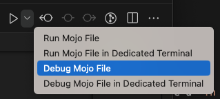
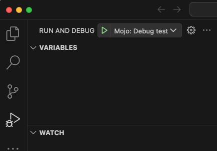

{/* VERIFIED: code/tools/debugging/ (tests.mojo, test_debugging.sh);
     mojo debug --help; mojo build --help;
     Mojo/stdlib/std/builtin/_startup.mojo, error.mojo, range.mojo;
     Mojo/lib/CompilerRT/System.cpp;
     Mojo/lib/MojoLLDB/Language/MojoLanguageRuntime.cpp
     Compiler verified: 2026-11-20, Mojo 1.3.0.dev2026111805 (310936c5)
     Tested on macOS arm64 and Linux aarch64. Not tested on Linux x86-64.
     VS Code sections checked by hand with extension 26.6.1.
     Last updated: 2026-11-20 (rewrite) */}

When a Mojo program crashes, raises an unexpected error, or produces the
wrong result, start with the quickest tool that helps you find the cause.
Print values, examine crash reports, or step through the program in a
debugger to understand what went wrong and how to fix it.

The examples use the following program. It sorts a row of pixel brightness
values into histogram bins:

<details>

<summary>Click to expand the histogram example</summary>

```mojo title="histogram.mojo"
from std.sys import is_defined, stderr


@fieldwise_init
struct Histogram(Movable):
    var bins: List[Int]
    var samples: Int


def bin_index(value: UInt8, bin_count: Int) -> Int:
    var index = Int(value) * bin_count // 256
    comptime if is_defined["TRACE_BINS"]():
        print("bin_index:", value, "->", index, file=stderr)
    comptime if is_defined["BREAK_ON_BAD_BIN"]():
        if index >= bin_count:
            breakpoint()
    return index


def build_histogram(pixels: List[UInt8], bin_count: Int) raises -> Histogram:
    if bin_count <= 0:
        raise Error("bin count must be positive")
    var bins = List[Int](length=bin_count, fill=0)
    for p in pixels:
        bins[bin_index(p, bin_count)] += 1
    return Histogram(bins^, len(pixels))


def main() raises:
    var source = String("frame-07.ppm")
    var pixels: List[UInt8] = [12, 200, 37, 255, 128, 90, 64, 241]
    var hist = build_histogram(pixels, 4)
    for i in range(len(hist.bins)):
        print(source, "bin", i, "->", hist.bins[i])
```

</details>

## Print values as the program runs

Printing intermediate values offers a fast way to find wrong results.
Send debug output to standard error with `file=stderr`, so it stays
separate from the program's normal output. You must import `stderr` from
`std.sys`.

```mojo
from std.sys import stderr


def main():
    var pixels: List[UInt8] = [12, 200, 37, 255]
    print("pixels read:", len(pixels), file=stderr)
    print(pixels[1])
```

The histogram example uses the `TRACE_BINS` compile-time define to control
debug output. Enable it on the command line:

```bash
mojo run -D TRACE_BINS histogram.mojo
```

Each call to `bin_index()` now reports its input pixel and the bin it chose.
Without `-D TRACE_BINS`, the program contains no trace code at all. For more
about defines, see
[Compile-time defines](/docs/tools/feature-toggles#compile-time-defines).

## Read a crash report

When a Mojo program crashes, it prints a stack trace showing the active
function calls. Crashes can result from an explicit call to
[`abort()`](/docs/std/os/os/abort/) or a fault such as a segmentation
fault:

```mojo title="crash.mojo"
from std.os import abort


def checked_divide(total: Int, count: Int) -> Int:
    if count == 0:
        abort("average of an empty frame")
    return total // count


def main():
    print(checked_divide(784, 0))
```

To show the file and line number for each stack frame:

1. Build with debug information. The `-g1` flag adds line tables,
   which are sufficient for stack traces:

   ```bash
   mojo build -g1 crash.mojo
   ```

2. Run the program with `llvm-symbolizer` on your `PATH`. The Mojo
   environment includes it, and `pixi run` adds the environment to
   `PATH`:

   ```bash
   pixi run ./crash
   ```

   Outside pixi, set `LLVM_SYMBOLIZER_PATH` to the `llvm-symbolizer`
   binary in your environment's `bin` directory.

`abort()` prints its message and the file and line where it was called.
The stack trace then shows `checked_divide()` and `main()`, with file
and line numbers for each.

Without debug information, the trace shows fewer frames and no line
numbers. Without `llvm-symbolizer`, it shows no line numbers and many
frames appear as bare addresses.

An error that `main()` doesn't handle ends the program with an error
message but no stack trace. To find where the error originated, set a
breakpoint on the `raise` statement, as described in the following
sections.

## Stop at a breakpoint

The [`breakpoint()`](/docs/std/builtin/breakpoint/breakpoint/) function
pauses execution in the debugger. The debugger shows the line after the
call as the current line. Without an attached debugger, `breakpoint()`
crashes the program.

Guard each `breakpoint()` call with a compile-time define, as
`bin_index()` does with `BREAK_ON_BAD_BIN`. This keeps breakpoints out
of normal builds:

```bash
mojo debug -D BREAK_ON_BAD_BIN histogram.mojo
```

This command builds the program with the breakpoint enabled and starts
it in the debugger. The next section walks through the debugger session.

## Debug from the command line

The `mojo debug` command builds a Mojo file without optimization and with
full debug information, then starts an [LLDB](https://lldb.llvm.org/)
session. Mojo includes LLDB and a Mojo plugin for it.

```bash
mojo debug histogram.mojo
```

At the `(lldb)` prompt, set breakpoints, then enter `run`. LLDB warns
that it can't resolve a breakpoint until the program loads. Once the
program starts, LLDB resolves the breakpoint and stops there.

{/* markdownlint-disable MD013 */}

| Command                                       | What it does                                         |
|-----------------------------------------------|------------------------------------------------------|
| `b histogram.mojo:25`                         | Stops at line 25 of `histogram.mojo`.                |
| `b build_histogram`                           | Stops when `build_histogram()` starts.               |
| `breakpoint set -f histogram.mojo -l 25 -i 4` | Stops at line 25 after skipping the first four hits. |
| `run`                                         | Starts the program.                                  |
| `c`                                           | Continues to the next breakpoint.                    |
| `n`                                           | Runs the current line, stepping over calls.          |
| `s`                                           | Runs the current line, stepping into calls.          |
| `finish`                                      | Runs until the current function returns.             |
| `bt`                                          | Shows the call stack.                                |
| `up`, `down`                                  | Moves to the calling frame or back.                  |
| `v`                                           | Shows values in the current frame.                   |
| `v pixels`                                    | Shows one value. Use `v hist.bins` for a field.      |
| `quit`                                        | Ends the session.                                    |

{/* markdownlint-enable MD013 */}

For example, enter `b histogram.mojo:25`, then `run` to stop inside
the loop in `build_histogram()`. Use `v pixels` to inspect the list's
size and elements. Enter `s` to step into `bin_index()`, then `finish`
to return to the loop. Enter `up` to move to `main()`, where `v source`
shows `"frame-07.ppm"`.

The `v` command displays structs field by field, lists with their
size and elements, and strings as text. Use `v` rather than `p` to
inspect values. The `p` command evaluates expressions but supports
only plain values and fields. See [Limitations](#limitations).

Mojo destroys values after their last use. Once a value is destroyed,
the debugger reports it as unavailable. For example, after the last
use of `pixels`, `v pixels` shows `<variable not available>`.

### Debug a built program or a running process

`mojo debug` also starts a debugging session for a program built with
`mojo build`, or attaches to a running process:

```bash
mojo debug ./histogram
mojo debug --pid 4321
mojo debug --process-name histogram
```

For source-level debugging, build with `-O0 -g`. On macOS, these
sessions don't show source lines. See [Limitations](#limitations).

:::tip

For a full list of command-line options, see the [`mojo debug` reference
page](/docs/cli/debug).

:::

## Debug in VS Code

{/* markdownlint-disable MD013 */}

The Mojo extension for [VS Code](https://code.visualstudio.com) and near
relations like [Cursor](https://cursor.so) runs the same debugger in the editor.
Install it from the
[Visual Studio Code Marketplace](https://marketplace.visualstudio.com/items?itemName=modular-mojotools.vscode-mojo)
or [Open VSX](https://open-vsx.org/extension/modular-mojotools/vscode-mojo).

{/* markdownlint-enable MD013 */}

To use the Mojo extension, you must also [install the `mojo`
package](/install/), or, if you're developing for the MAX framework,
[install MAX](https://max.modular.com/install/), which includes the `mojo`
package.

The `mojo` package includes the [LLDB debugger](https://lldb.llvm.org/) and a
Mojo LLDB plugin. Together these provide the low-level debugging interface for
the Mojo extension. You can also use the `mojo debug` command to start a
command-line debugging session using LLDB or to launch a Mojo debugging session
in VS Code.



The `mojo` package also includes support for debugging Mojo programs running on
GPU. This requires some extra software and configuration. Currently GPU
debugging only works with NVIDIA GPUs. For details, see
[GPU debugging](https://max.modular.com/gpu/debugging/).

With VS Code open, start a debugging session from the terminal:

```bash
mojo debug --vscode histogram.mojo
```

With one VS Code window open, `mojo debug` starts the session there.
Program output appears in the **Debug Console**. When execution stops,
press **Continue** (<kbd>F5</kbd>) to resume.

The **Debug Console** also accepts commands while execution is stopped.
Prefix LLDB commands with a colon, such as `:v` or `:bt`. Entries without
a colon are evaluated as expressions, with the same limitations as `p`.

The **Run and Debug** view includes a button to launch debug sessions and a
menu to select debug configurations. It also has areas to display current
variables, watch expressions, the current call stack, and breakpoints.



Each session starts with two errors about importing `lldbDataFormatters.py`
and `mlirDataFormatters.py`. These errors don't prevent the debugger
from working.

For complete coverage of VS Code's debugging features, see [Debugging in
Visual Studio Code](https://code.visualstudio.com/docs/editor/debugging).

## Debug GPU code

To debug code running on a GPU, see
[GPU debugging](https://max.modular.com/gpu/debugging/).

## Limitations

- **Expressions.** `p` reads plain values and fields but doesn't evaluate
  arithmetic, function calls, or subscripts such as `pixels[1]`.
  Unsupported expressions often produce no output. In the VS Code Debug
  Console, a subscript may print a crash report, but the session continues.
  `v` doesn't support subscripts either.
- **Conditional breakpoints.** Breakpoint conditions fail to evaluate, so
  the debugger stops on the first hit. Hit counts work.
- **Break on raise.** `breakpoint set -E mojo` stops at every `raise`,
  including when a `for` loop ends because its iterator raises
  `StopIteration`. Instead, set a breakpoint on the specific `raise`
  statement you want to investigate.
- **Return values.** `finish` doesn't display the function's return value.
- **Type names.** Some scalar types appear under internal names. For
  example, `Int` appears as `` __mlir_type.`!kgen.scalar<index>` ``.
- **Hidden arguments.** Stack frames include compiler-generated arguments
  such as `__error__` and `__result__`.
- **Raised errors.** `MODULAR_DEBUG=stack-trace-on-error` collects a stack
  trace only for errors created from a string literal or multiple
  arguments, such as `Error("bad header: ", line)`. Errors created from
  a single `String` have no trace. On macOS, the trace stops inside the
  standard library without showing the line that raised the error.
- **Built programs on macOS.** `mojo build` stores debug information in
  temporary files that it deletes after building. The debugger therefore
  can't show source lines for the built program. Debug the source file
  with `mojo debug` instead.

## Troubleshooting

### File paths or line numbers are wrong

The compilation cache reuses a build when the source differs only in
blank lines or its directory location. The reused build reports the
original file paths and line numbers in `abort()` messages, crash traces,
and the debugger.

If a reported location points to the wrong file or line, set
`MODULAR_CACHE_DIR` to an empty directory and rebuild:

```bash
MODULAR_CACHE_DIR=$(mktemp -d) mojo build -g1 crash.mojo
```

### The debugger can't start on Linux

- **Missing `libncurses.so.6`.** If `mojo-lldb` can't load this library,
  install your distribution's ncurses package, such as `libncurses6`
  on Ubuntu.
- **Docker permissions.** If LLDB reports `personality set failed` when
  launching a program, or a `ptrace_scope` error when attaching, start
  the container with `--cap-add=SYS_PTRACE --security-opt seccomp=unconfined`.
