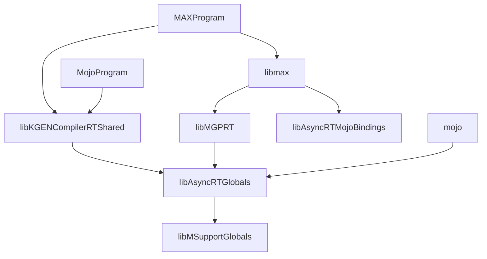

# Dynamic linking

This doc explains our approach to dynamic linking in the monorepo, including
patterns, rules, and restrictions.

## General guidelines

Avoid using `-fvisibility=default`. This exposes every compiled symbol in the
binary, which makes binaries larger, and can cause subtle ODR violations. If you
do use this (we have a few places where we do), use in very narrow scopes or
provide a linker script to select exported symbols at link time. Prefer
specifically annotating each symbol that you wish to expose with default
visibility.

When multiple shared libraries are used in a single executable, avoid statically
linking the same target into multiple of them. `rules_cc` enforces that each
target is linked into exactly one.

If, and only if, the target does not expose global state, you can avoid
`rules_cc`'s check by tagging it with `LINKABLE_MORE_THAN_ONCE`. This should be
used sparingly (following guidance from
https://bazel.build/reference/be/c-cpp#cc_shared_library_args), for our repo
only use it for cases where the above holds and it either improves runtime
performance or avoids linking to a much larger DSO.

For tests, any linking strategy is appropriate (the default is full static
linking). If using dynamic libraries as dependencies, be careful about pulling
excessive extra dependencies.

Keep runtimes small. CompilerRT, for example, should not depend on the large
libLLVM.

For distributed binaries (libmax, mojo, etc), keep large, shared dependencies
(like LLVM) in their own shared objects. Anything used in a single binary
should be statically linked. For small dependencies that are used in multiple
entrypoints, default to linking once into a shared library, but you may wish to
statically link into multiple binaries either for performance or to avoid larger
dependencies in some cases (i.e. runtimes).

Use `-Wl,-Bsymbolic-functions` where appropriate. This flag causes functions to
always resolve in the same shared library as the caller, which can improve
performance slightly (avoiding the normal DSO lookup cadence). This can also be
a functional requirement: If you have global state linked into multiple binaries
(discouraged, but possible), you can use this to force resolving to the local
copy instead of potentially one of the others.

Following these guidelines may require splitting targets so that some "lighter"
pieces are their own targets.

## DSO graph

This shows the main DSOs and binaries, not exhaustive.

## Follow-ups

The runtime libraries (CompilerRT, libAsyncRTGlobals, and the runtime half of
libmax) still depend on libLLVM and libMLIR. To remove that, in order:

1. Remove MLIR from shared support code: move `configurePassManager` out of
   `//Support:Base`, split the MLIR hashing out of `//Support:HashUtils`, and
   drop clang from `//Support:MArchTargetMinimal`.
2. Move compiler libraries (`//Support:MDialect`, `//Support:MArchTarget`,
   `//Support:Compiler`) out of libAsyncRTGlobals and into a compiler-side
   library.
3. Split libmax into a runtime library and a compiler library.
4. Give the runtime libraries the LLVM utilities they still use (filesystem,
   streams, JSON, `APFloat`) without libLLVM, checking every type that crosses
   into the compiler.
5. Make CompilerRT independent of libLLVM, and decide whether standalone Mojo
   programs need a fully static runtime.
