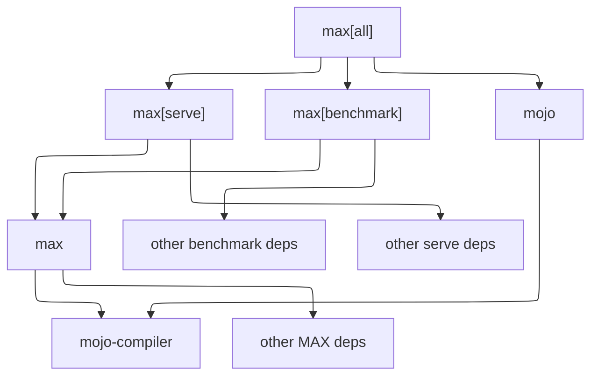

You can choose how many MAX dependencies to install
based on what you want to do.

The `max[all]` package includes all dependencies, including model
serving, benchmarking, and the full Mojo SDK. The smaller packages let you
install only the tools you need.

For installation instructions, see [Install MAX](/install/).

## Choose a package

The following diagram shows how the packages relate to one another and which
dependencies they include.

### `max[all]`

Install `max[all]` to get every MAX dependency, including `max[benchmark]`,
`max[serve]`, and `mojo`.

| Installer  | Package    |
|------------|------------|
| pip/uv     | `max[all]` |
| conda/pixi | `max-all`  |

### `max[benchmark]`

Install `max[benchmark]` to use the [`max benchmark`](/cli/benchmark/) command.
This package includes `max` and the third-party dependencies required for
benchmarking.

| Installer  | Package          |
|------------|------------------|
| pip/uv     | `max[benchmark]` |
| conda/pixi | `max-benchmark`  |

### `max[serve]`

Install `max[serve]` to create an inference endpoint with the
[`max serve`](/cli/serve/) command. This package includes `max` and the
third-party dependencies required for serving.

| Installer  | Package      |
|------------|--------------|
| pip/uv     | `max[serve]` |
| conda/pixi | `max-serve`  |

### `max`

Install `max` to use the core MAX libraries and tools. It includes:

- [`max` CLI](/cli/): Provides commands for working with MAX. The `serve` and
  `benchmark` commands require `max[serve]` and `max[benchmark]`, respectively.
- [MAX Python library](/api/python/): Provides APIs for building models.
- [MAX accelerator library](/api/mojo/): Provides APIs for accelerating
  inference with GPUs.
- [MAX C API](/api/c/): Provides APIs for running inference without an endpoint.

The `max` package depends on `mojo-compiler` and a minimal set of third-party
packages.

To get the full set of Mojo developer tools, install the larger `mojo` package,
which is included in `max[all]`. For details, see [What's included in the Mojo
SDK](https://mojolang.org/docs/faq/#whats-included-in-the-mojo-sdk).

Your dependency tree will show other "max" packages such as `max-core`.
These are required sub-packages that you should never explicitly
install or define as project dependencies.

## Stable and nightly builds

MAX provides stable and nightly builds with different release cadences.

- **Stable builds** follow the stable release schedule and are published as
  versioned releases.
- **Nightly builds** are published nightly and include changes from ongoing
  development.

If you're using a stable build and want to clone the [Modular
repo](https://github.com/modular/modular), check out the `stable` branch with
`git clone -b stable https://github.com/modular/modular.git`.

To see what's in each version, go to the [release notes](/releases/).
