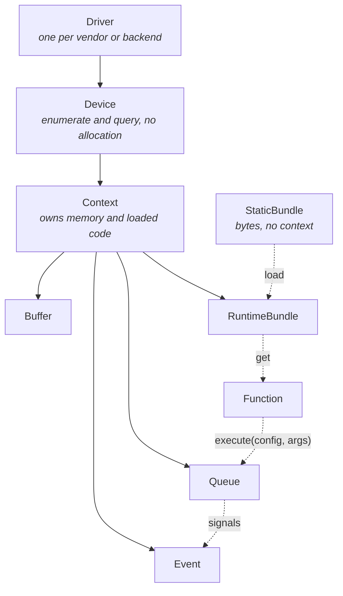
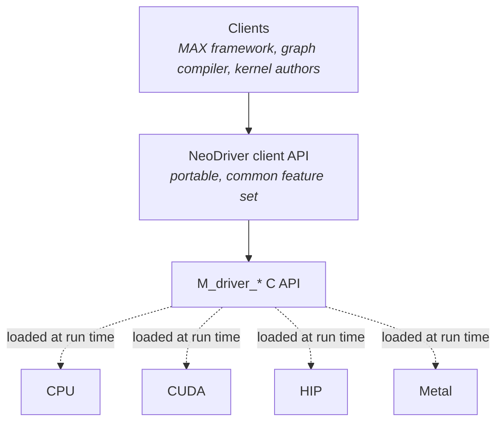

# NeoDriver

NeoDriver is the MAX driver API: the layer that finds accelerators, allocates
their memory, loads compiled kernels, and submits work to them. It replaces the
legacy `DeviceContext` API with a set of smaller objects, and it has two faces:

- A **client API** in Mojo, for the MAX framework, the graph compiler, and
  kernel authors that drive hardware.
- A **vendor API**, for hardware vendors that bring a new device to MAX.

This page explains the design and the reasons behind it. For the C interface
that vendor plugins implement, see `SDK/include/HAL/`.

The code lives in these places:

| Component                    | Path                                               | Contents                                                            |
|------------------------------|----------------------------------------------------|---------------------------------------------------------------------|
| Client API                   | [`hal/`](hal/)                                     | `Driver`, `Device`, `Context`, `Queue`, `Stream`, `Event`, `Buffer` |
| `DeviceContext` compat layer | [`device_context_hal/`](device_context_hal/)       | The `DeviceContext` API, rebuilt on top of the client API           |
| Execution configurations     | [`hal/execution_config/`](hal/execution_config/)   | Launch configuration traits and per-vendor implementations          |
| Extensions                   | [`hal/extensions/`](hal/extensions/)               | Capability traits and per-vendor extension sets                     |
| Hardware abstraction layer   | `SDK/include/HAL/`                                 | The `M_driver_*` C interface that every plugin implements           |

> [!NOTE]
> The client API is still incubating, and its surface changes as consumers
> move to it. Code samples marked **proposed** show the intended design, not
> the API as it exists today.

## Status

NeoDriver is the driver API MAX is moving to, but it isn't the production path
yet:

- MAX runs on the legacy `DeviceContext` by default. The CUDA, HIP, Metal, and
  CPU plugins implement the NeoDriver C interface, and MAX runs on them through
  the `DeviceContext` compat layer when built with
  `--config=hal-device-context`.
- The `M_driver_*` C interface is at version 0.1.0 and changes without notice.
  Its launch configuration for accelerators other than GPUs is provisional.
- We're bringing accelerators that aren't GPUs onto NeoDriver, and their
  plugins aren't part of this repository yet. Where this page mentions such
  devices, it describes the design, not supported hardware.

## Why replace `DeviceContext`

`DeviceContext` is one C++ object per device, subclassed per vendor. It
represents the device, owns a stream, the caching allocator, the kernel loader,
and kernel launching. Everything goes through it.

Over time, more operating modes were layered onto that one object, and its
callers came to rely on defaults shaped like the CUDA driver API. Concepts that
the hardware keeps separate blurred together: a `DeviceContext` doubles as a
stream, and a buffer owns a stream.
Every new mode added state, and the number of invalid combinations grew with
it, along with the footguns around pinned memory and blocking streams.

NeoDriver starts from the hardware that exists. It splits the one object into
several (driver, device, context, queue, bundle), each with one job and
explicit behavior.

To keep existing code running while the client API settles, the
**`DeviceContext` compat layer** provides the familiar `DeviceContext` API,
rebuilt on NeoDriver. Build with `--config=hal-device-context` to use it in
place of the legacy implementation. Consumers move to the client API over
time, and the compat layer goes away once they have.

## Concepts

NeoDriver uses the following terms:

- **Driver**: The runtime instance of one loaded backend plugin, such as CUDA,
  HIP, Metal, or CPU. It's the entry point for one vendor's hardware, and
  enumerates that vendor's devices without creating contexts or allocating
  memory. A process typically holds more than one driver, for example one for
  the CPU and one for CUDA. Devices from different vendors never mix under one
  driver. A driver plays the role of an initialized vendor library, such as
  CUDA after `cuInit()`.
- **Device**: One physical piece of hardware that a driver exposes,
  corresponding to a `CUdevice`. It's a read-only description you can query
  for architecture, attributes, and properties. Querying a device doesn't
  allocate or fragment device memory, which keeps enumeration cheap. Unlike a
  `DeviceContext`, a device doesn't execute work or own resources.
- **Context**: The owner of all resources on one device: allocations, loaded
  code, queues, and events. You use it to allocate memory, load bundles,
  retrieve functions, and create queues and events. A context doesn't imply
  any ordering of work; ordering belongs to queues. Its CUDA counterpart is
  `CUcontext`.
- **Queue**: A handle for submitting work to a context. It accepts copies,
  fills, kernel executions, and event operations. A backend can run that work
  as a stream, as several streams, as a command buffer, or as a device graph.
  A queue guarantees only start-to-start ordering: an operation doesn't begin
  before the previous one has begun. There is no default queue; all work goes
  to a specific queue.
- **Stream**: A queue with first-in, first-out (end-to-start) ordering, the
  equivalent of a CUDA stream. Code that depends on in-order execution runs
  unchanged on a stream. On backends whose queues are already in order, a
  stream adds no cost; on others, it inserts the events it needs between
  operations.
- **Event**: An explicit dependency between units of work. A queue signals an
  event when the work before it completes, and another queue or the host waits
  on it. Events are how you get any ordering stronger than start-to-start. CUDA
  and Metal provide the same primitive as `CUevent` and `MTLSharedEvent`.
- **Buffer** and **BufferView**: A buffer is a single allocation of device
  memory or pinned host memory owned by a context, like a `CUdeviceptr` or
  `MTLBuffer`. A buffer view is a non-owning window (memory, offset, size) into
  a buffer, and is the form that all copy, set, and fill operations accept.
- **Bundle**: Roughly a module or library: a container of device functions and
  their metadata that you can store, marshal, load, and reference.
  - A **StaticBundle** is an unloaded bundle: compiled device code as bytes
    (`cubin`, `hsaco`, `metallib`) that needs no context or device to store or
    transmit.
  - A **RuntimeBundle** is a static bundle that a vendor driver has loaded into
    a context, ready for use.
- **Function**: A single executable entry point retrieved from a runtime
  bundle, the equivalent of a `CUfunction` or `MTLComputePipelineState`. You
  execute it on a queue with an execution configuration and arguments. Most
  callers never handle functions directly.

## Client API

The client API aims past the usual tradeoff in device abstraction. It offers
lower runtime overhead, more portability, and deeper device specialization
where you want it, three goals usually seen as in tension. Mojo's compile-time
metaprogramming makes this possible: an abstraction based on capabilities can
fold away entirely at compile time. The same approach drives unified kernel
launch, `DevicePointer`, and plugin hooks, each of which specializes for a
device with no runtime cost.

NeoDriver applies those principles to driving the device. The API captures what
you intend to do, and lets each backend reuse shared implementations while
customizing the parts that make its hardware unique.

The following diagram shows how the client API objects relate:



The following table maps each NeoDriver object to its CUDA and Metal
counterparts:

| NeoDriver     | CUDA                       | Metal                                       |
|---------------|----------------------------|---------------------------------------------|
| Driver        | Driver library (`cuInit`)  | System framework                            |
| Device        | `CUdevice`                 | `MTLDevice`                                 |
| Context       | `CUcontext`                | `MTLDevice` (not split)                     |
| Queue         | `CUstream` or `CUgraph`    | `MTLCommandQueue` and `MTLCommandBuffer`    |
| StaticBundle  | cubin or fatbin bytes      | metallib bytes                              |
| RuntimeBundle | `CUmodule` or `CUlibrary`  | `MTLLibrary`                                |
| Function      | `CUfunction`               | `MTLComputePipelineState`                   |
| Event         | `CUevent`                  | `MTLSharedEvent`                            |
| Buffer        | `CUdeviceptr`              | `MTLBuffer`                                 |

### Drivers are objects, not singletons

A driver is a runtime handle to the state of one vendor's driver, including
loading and unloading its plugin. Because it's an object, you can reset driver
state safely without restarting the Mojo program.

It also keeps vendors apart. Counting the CPU, a process often has two drivers
loaded, and the API a CPU exposes differs from an accelerator's, just as it
differs between accelerator vendors and generations. Since drivers are separate
from contexts, you can create a driver and enumerate its devices without
creating contexts and without mixing up devices from different vendors.

### Device, then context

Device enumeration is separate from context construction. Querying a device for
information doesn't allocate or fragment device memory, so enumeration stays
cheap.

### Bundles and functions

You load a `StaticBundle` to get a `RuntimeBundle`, ask the `RuntimeBundle` for
a `Function`, and execute the `Function` with an execution configuration on a
`Queue` or `Stream`. Most callers never see these steps, because
`DeviceContext.enqueue_function()` compiles, loads, caches, and launches in one
call. The individual steps are there for consumers with detailed requirements
around compiling device functions and marshaling their arguments.

### Queues

A queue is a handle you submit work through. You get queues from a context, and
one context can hand out several. Two choices shape the design:

- **No default stream.** All work goes into a specific queue, with that queue's
  ordering. This separates a context from its submission handles, which enables
  real multi-stream work such as overlap scheduling and overlapping kernel
  execution.
- **Start-to-start ordering.** A stream runs end-to-start: each operation waits
  for the previous one to finish. A queue only promises that an operation
  doesn't begin before the previous one has begun. Anything stronger needs an
  explicit dependency, expressed with an event. The looser promise lets a
  backend run the same queue as a stream, as several streams, as a command
  buffer, or as a device graph, and overlap independent work.

A *command buffer* records a batch of work and submits it all at once; it's
native on Metal and Vulkan, and many NPUs work in a similar way. A *device
graph* records work and its dependencies once, then replays it cheaply many
times; CUDA Graphs is the familiar example.

The queue abstraction is still incubating. While it settles, `Stream` sits on
top of it and inserts synchronization where a backend that isn't a stream needs
it. Expect the queue to grow toward full device graph building before it
stabilizes.

### Unified kernel launch

Launching a kernel shouldn't need a bespoke call site for each platform or
kind of device. Unified kernel launch provides an API, based on capabilities,
for configuring each aspect of a launch. You express what you want, and the
metaprogram lowers it so that:

- The launch specializes fully to the device, with nothing lost to
  over-abstraction.
- Any overhead folds away at compile time, with no unused configuration
  carried at run time.

Each backend declares its launch configuration type, and the traits it conforms
to in [`execution_config/`](hal/execution_config/) say what it
supports: `GridBlockExecutionConfig` for GPU-style grids and blocks,
`CoresExecutionConfig` for a core count, and others. Generic code branches on
those traits instead of on a vendor. The same approach works through the
`DeviceContext` compat layer, so you can migrate code eagerly.

The following **proposed** example launches a kernel on whatever device it's
compiled for:

```mojo
var config: ctx.ExecutionConfigType

# No vendor appears here; a new GPU-like backend can just work.
comptime if conforms_to(ctx.ExecutionConfigType, GridBlockExecutionConfig):
    config = ctx.ExecutionConfigType(grid_dim=(4, 1, 1), block_dim=(1024, 1, 1))
# Asking only for cores covers CPUs and NPUs.
elif conforms_to(ctx.ExecutionConfigType, CoresExecutionConfig):
    config = ctx.ExecutionConfigType(num_cores=num_cores)
else:
    comptime assert False, "no launch configuration for this device"

queue.execute[vec_add](config^, dev_a, dev_b, dev_c, size)
```

## Vendor API

One size fitting all is a good goal, but MAX targets hardware of very different
shapes and capabilities. The vendor API has to capture what makes each device
fast, and adapt over the differences, through three mechanisms:

- The **hardware abstraction layer (HAL)** for functionality every backend
  shares.
- **Plugin hooks** for Mojo implementations of behavior specific to a device or
  vendor.
- **Capability-based extensions** for features that only some backends have.

The following diagram shows where vendor plugins sit:



### HAL plugins

The HAL is a small, vendor-neutral C interface, declared in `SDK/include/HAL/`.
Each backend provides a plugin: a shared library that implements at least the
core HAL functions, loaded at run time. Truly universal functionality, such as
device enumeration and context creation, needs no extra ceremony: every plugin
supports it, and its exported symbols form a base table with the declared
function prototypes. A shared conformance test suite runs against every plugin.

### Plugin hooks

Plugin hooks are compile-time Mojo implementations of behavior specific to a
device or vendor behind a common API. Each backend declares a `HalPluginHooks`
struct (see
[`hal/_plugin/_trait.mojo`](hal/_plugin/_trait.mojo)) with its
execution configuration type and its extension set. Optional hooks left as
`None` add no cost.

Hooks overlap with standard library plugins: a vendor can use a hook point to
override functions such as `exp()`, `tanh()`, or `abort()`, or to pick the
`DType` used in some situation. Hooks are also what carries capability-based
extensions: a common hook *holds* the extensions a vendor implements.

In short, plugin hooks are what the *compiler* knows about a backend, and the
HAL plugin is what the backend does at *run time*.

### Capability-based extensions

It isn't always possible, or useful, to abstract differences between hardware
away. Instead, extensions give you a way to discover and use them, and
compile-time evaluation folds away any overhead. This generalizes the technique
behind unified kernel launch to other domains.

A capability is a versioned `Supports<Name>V<N>` trait. Each device holds its
backend's extension set as `extensions`, and you branch on a capability with
`conforms_to()`. Inside the branch the type is refined, so the capability's
methods are only visible where they're supported, and you can't call them by
accident. For example, peer access between devices:

```mojo
comptime Ext = type_of(device.extensions)
comptime if conforms_to(Ext, SupportsPeerAccessV1):
    var peer_access = device.extensions.peer_access()
```

Declaring an extension doesn't require changing the core driver. A backend
defines and implements an interface, and the only requirement is that kernels
that want to use it can import the trait.

Extensions are also a path for prototyping and promotion. Features such as
`MTLTensor` on Metal and the Tensor Memory Accelerator (TMA) on CUDA don't map
well onto a shared API today. As extensions, they can ship without forcing a
shared API on backends that don't fit it, and a common tensor type can
graduate into the HAL later if enough backends converge. Backends come up
quickly this way, while the shared API stays stable.

#### Example: graph capture (proposed)

> [!NOTE]
> This example is the **proposed** graph capture design, not the current API.
> Today, `GraphCaptureV1` has only `start_capture()` and `end_capture()`, which
> take no queue and return no graph, and no backend implements it yet.

Graph capture records the operations enqueued on a queue, then replays them.
The extension declares these traits:

```mojo
trait SupportsGraphCaptureV1(Deinitable, Movable):
    comptime GraphCaptureTy: GraphCaptureV1

    def graph_capture(ref self) -> ref[self] Self.GraphCaptureTy:
        ...


trait GraphCaptureV1(Deinitable, Movable):
    """Captures operations enqueued on a queue into a replayable graph."""

    comptime GraphTy: CapturedGraphV1

    # Methods can be parametric, and can use other extensions.
    def begin_capture(self, queue: QueueHandle) raises HALError:
        """Begins recording operations enqueued on `queue` into a graph."""
        ...

    def end_capture(self, queue: QueueHandle) raises HALError -> Self.GraphTy:
        """Ends capture and returns the captured graph."""
        ...


trait CapturedGraphV1(Deinitable, Movable):
    """A captured sequence of operations that can be replayed."""

    comptime GraphExecTy: ExecutableGraphV1

    def instantiate(self) raises HALError -> Self.GraphExecTy:
        """Returns an independent executable; the captured graph is kept."""
        ...


trait ExecutableGraphV1(Deinitable, Movable):
    """An instantiated graph, ready to replay."""

    def launch(self, queue: QueueHandle) raises HALError:
        """Replays the captured operations on `queue`."""
        ...
```

A caller uses the capability only where the backend has it:

```mojo
comptime if conforms_to(type_of(device.extensions), SupportsGraphCaptureV1):
    device.extensions.graph_capture().begin_capture(queue)
```

The backend's implementation lives in its plugin module, which kernels don't
need to import. It can declare its own runtime types and its own table of
symbols for the vendor plugin to implement, which is often the part that varies
most between vendors:

```mojo
struct GraphCapture(
    GraphCaptureV1, HALPluginConstructable, TrivialRegisterPassable
):
    comptime GraphTy = CapturedGraph

    var _fns: OptionalReg[RawPluginGraphCapture]

    ...
```

## Compile-time configuration

Because so much resolves at compile time, the running program contains only the
chosen backend's path, with little conditional execution at run time. An
unsupported operation is a compile error rather than a runtime failure or a
silent fallback.
