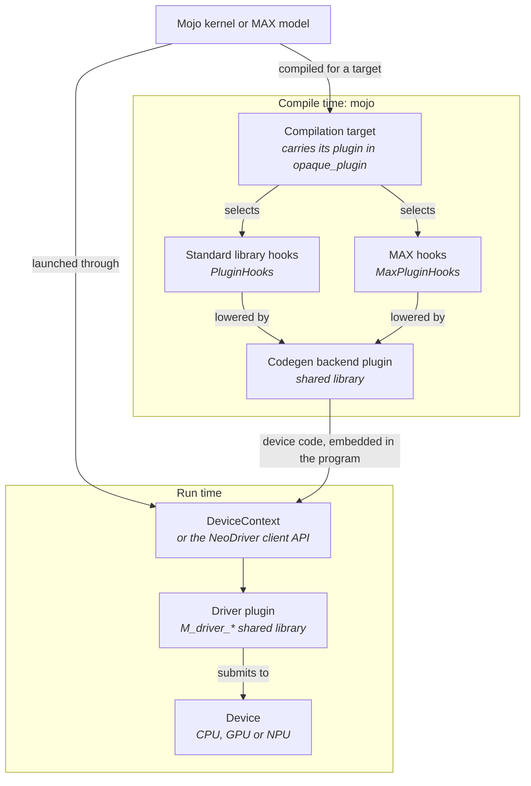

# Hardware plugins

Mojo and MAX reach a new device through four extension points, so a vendor can
add support for its hardware without forking the stack. Two are Mojo traits of
compile-time hooks, and two are shared libraries:

- `PluginHooks` specializes the standard library, such as math, casts,
  atomics, and printing.
- `MaxPluginHooks` specializes MAX, such as barriers, warp shuffles, and
  elementwise launches.
- A codegen backend plugin teaches the Mojo compiler to emit code for the
  device.
- A driver plugin finds the device, manages its memory, and runs work on it.

The compilation target ties the two hook traits to the device: a target
carries its plugin, so passing a target to the compiler selects its hooks.



The hooks are resolved when Mojo code compiles, whether through `mojo` or when
MAX compiles a model's kernels, so a hook left at its default costs nothing at
run time. The codegen backend and the hooks take part only in compiling; the
driver plugin runs the compiled code.

## Where to start

One order that works for bringing a device up is below. Steps 1 to 3 need no
hardware:

1. Write a codegen backend plugin, so that `mojo` can emit code for the
   device's triple.
2. Write a standard library plugin that sets `device_kind`, and a target that
   carries it. Compile a small kernel for that target with `compile_info` and
   read the code it produces.
3. Write a MAX plugin that sets `warp_size`, and add it to the target.
4. Write a driver plugin and pass the conformance suite in
   `Target/test/PluginTest.cpp`.
5. Run a kernel on the device through a `DeviceContext` built with
   `--config=hal-device-context`.

## How a target selects its plugin

A compilation target is a `#kgen.target` attribute: a triple, an arch,
features, and other data the compiler needs. Its `opaque_plugin` field holds
Mojo types, the plugin structs for that target. The standard library reads the
active plugin from the target it's compiling for:

```mojo
comptime CurrentPlugin: PluginHooks = CompilationTarget.current().stdlib_plugin
```

The MAX hooks are selected the same way. When you compile a kernel for a
target, with `compile_info[kernel, target=T]()` or through a `DeviceContext`
parameterized on `T`, every hook call inside it, including calls deep in
library code, resolves to `T`'s plugin. A target that carries its plugins
needs no registry entry for them and no separate build of the standard
library.

> [!WARNING]
> A target named only by its triple, such as one passed with `--target-triple`,
> carries no plugin. An NVIDIA, AMD, or Apple GPU target without one gets that
> vendor's builtin plugin, and any other target gets `DefaultPlugin`, which
> keeps every hook at its default.

The builtin targets show the pattern: each vendor lists its devices in a
`TargetAcceleratorCollection`, and each device's target carries that vendor's
standard library and MAX plugins. See [`cuda/targets.mojo`](cuda/targets.mojo).

## Standard library hooks

`PluginHooks` (`std/_plugin/_trait.mojo` in the standard library) is a trait of
`comptime` members. Most are optional functions that default to `None`, which
means "keep the standard library's own lowering." A plugin overrides only what
its device needs, and the choice is made at compile time.

A minimal plugin has two parts: a struct with a stable `name` that conforms to
`StdPlugin`, and a hooks struct, parameterized on the target:

```mojo
struct MyPlugin(StdPlugin):
    comptime name = "...".value
    comptime HookFor[target: CompilationTarget] = MyPluginHooks[target]
```

The hooks struct must at a minimum set the `device_kind` field:

```mojo
struct MyPluginHooks[target: CompilationTarget](PluginHooks):
    # Possible values: TargetDeviceKind.cpu, .gpu, and
    # .other(name, is_accelerator), e.g. `.other("npu", True)`.
    comptime device_kind = ...
```

Generic code asks `CompilationTarget.is_gpu()` and `is_accelerator()`, which
are derived from `device_kind`, so GPU-only paths stay off for an `other`
device.

The other hooks cover math lowerings, casts and native `float8` support,
atomics, address spaces, stack allocation, prefetch, thread and block ids,
`print`, timers, and `abort`. The trait grows as vendors need new override
points, so read it at the commit you build against.
`test_gpu_target_plugin.mojo` in the standard library's tests defines small
GPU and NPU plugins and targets that carry them.

## MAX hooks

`MaxPluginHooks` ([`_trait.mojo`](_trait.mojo)) is the same pattern for the
`max` package: elementwise launches, barriers and `syncwarp`, async-copy
groups, the four warp shuffles, `vote`, `match_any`, and `match_all`. Its one
required member is `warp_size`, which `WARP_SIZE` reads. A GPU plugin must
also lower `shuffle_idx_fn`: the other shuffles default to it, and a target
that leaves it out rejects every shuffle at compile time.

The layout library adds `LayoutPluginHooks`, which picks, for each address
space, the `TensorEngine` that tiles use to address their storage, such as a
memref handle in place of a raw pointer. The target doesn't select it: a
vendor registers it in the layout library's `_overlay.mojo`.

## Codegen backend plugin

The Mojo compiler loads codegen backends as shared libraries from the plugin
paths in `modular.cfg` or, if it lists none, from
`MODULAR_COMPILER_PLUGINS`, a `;`-separated list of paths. A backend exports
`M_KGEN_getTargetLowering`, `M_KGEN_getTargetTraits`, and
`M_KGEN_getTargetBackend`, and the compiler skips any entry point a backend
leaves out. A backend can wrap an existing LLVM backend for the device.

These entry points return C++ objects, so build a backend from the same commit
and build configuration as the `mojo` that loads it. The compiler loads each
backend with its own copy of LLVM and MLIR, so passes, command-line options,
and dialects that a backend registers aren't visible to the compiler. No
reference backend is public yet. The file that loads each entry point declares
its signature: `PluginTraits.cpp`, `PluginLowering.cpp`, and
`PluginBackend.cpp`, under the `max_license/Plugin/` directories of
`Mojo/lib/`.

## Driver plugin

A driver plugin is a shared library that implements the `M_driver_*` C
interface declared in `SDK/include/HAL/`. MAX models reach such a plugin only
through the `DeviceContext` compat layer (`--config=hal-device-context`),
which loads the plugins named in `MODULAR_DRIVER_PLUGINS`, a `;`-separated
list of `name@path` entries. The NeoDriver client API can also load a plugin
directly. The legacy runtime reads the same variable in another format, for an
older plugin interface that this page doesn't cover. Under the compat layer,
`mojo` also reads a single `name@path` entry from it to ask the driver for the
local accelerator's arch when you don't name a target. That query understands
only NVIDIA devices today, so name your device's target explicitly. The CPU,
CUDA, HIP, and Metal plugins in `Target/lib/` are working references, and
`Target/test/PluginTest.cpp` is the interface's conformance suite.

The [NeoDriver README](../_driver/max_license/README.md) covers the
driver's design, its Mojo client API, and the driver's own plugin hooks and
capability-based extensions. The interface is at version 0.1.0 and changes
without notice.

## Status

These interfaces are new and will keep changing. Each layer of the stack moves
toward them on its own schedule, through three stages:

1. A fork of the repository, which drifts as soon as it's made.
2. A build-time file overlay, which replaces only the files a vendor changes.
3. A plugin interface: the vendor implements a trait or a C interface, and the
   base code stays shared and unmodified.

The codegen backend and the standard library are plugin interfaces today.
Devices and the driver are in progress: the driver C interface exists, but MAX
still runs on the legacy `DeviceContext` by default. Some registration still
needs an overlay: adding a vendor's targets to `TARGETS` or a plugin to
`MAX_PLUGINS` in [`_overlay.mojo`](_overlay.mojo), adding a layout plugin to
the layout library's `_overlay.mojo`, and vendor-specific `DeviceContext`
methods. Outside an overlay build, edit those files in your checkout.

The goal is for a vendor to ship its support as one plugin bundle that the
stock `mojo` and `max` tools load, with no fork or overlay. That isn't
available yet.
